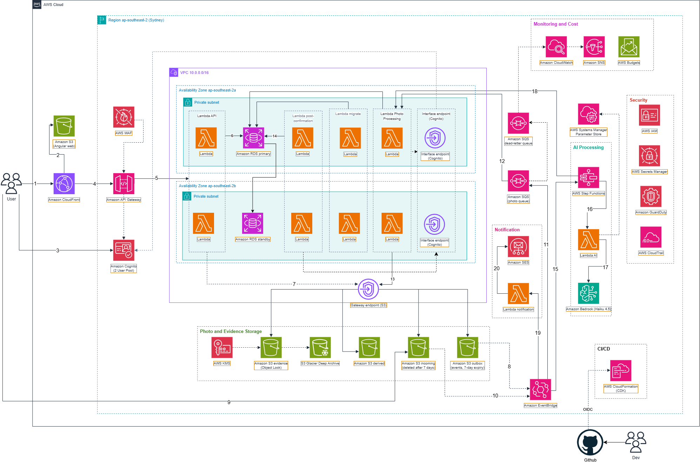

# RoomLedger

## A Serverless AWS Platform for Boarding-House Management with Tamper-Proof Photo Records and AI Meter Reading

### 1. Executive Summary

In large Vietnamese cities, disputes between boarding-house landlords and tenants usually come down to two things: the deposit at move-out (was the room damaged?) and the monthly electricity and water bill (what did the meter really show?). Both sides often have only verbal agreements or a few photos sent over chat.

RoomLedger is a serverless web application on AWS, deployed in ap-southeast-2 (Sydney), with three roles: administrator, landlord and tenant. It is sized for one boarding house with 30–50 rooms, that is 31–51 active users per month (one landlord and 30–50 tenants) plus the administrators. It stands out with two features: move-in photo records that are locked with Amazon S3 Object Lock once both sides confirm, and Amazon Bedrock (Claude Haiku 4.5) reading electricity and water meter photos to produce the monthly bill. Paper contracts are scanned by the landlord, confirmed by the tenant and locked in the same way.

### 2. Problem Statement

### What's the Problem?

Move-in records are often missing, or they are just a few scattered photos on each person's phone, so at move-out the two sides have no shared evidence. Photos can be claimed to be taken later, taken in another room, or edited. Each month the landlord reads the meters alone, and tenants who never see the meter tend to doubt the numbers.

Existing Vietnamese boarding-house apps (LOZIDO, Quản Lý Phòng Trọ Việt Nam) handle invoices, contracts and payment reminders well, but have no photo-based handover record and no AI. Foreign apps (Witnessed, PropCheckAI, DepositCam) record handover photos, but they do not manage boarding houses and do not require confirmation from both sides.

### The Solution

RoomLedger puts locked, two-party-confirmed photo records, AI meter reading and a move-out review into one flow, together with contracts, monthly invoices and deposit settlement.

The Angular web app is served from Amazon S3 through Amazon CloudFront. Users sign in with Amazon Cognito, and API calls go through Amazon API Gateway, protected by AWS WAF, to AWS Lambda (.NET 8) running in private subnets of an Amazon VPC. Data is stored in Amazon RDS for PostgreSQL (Multi-AZ).

Photos are uploaded directly from the browser to Amazon S3 with a SHA-256 checksum, flow through Amazon EventBridge and Amazon SQS to the photo-processing Lambda, and are copied to an evidence bucket with Object Lock when the record is locked. For meter photos, AWS Step Functions calls Amazon Bedrock to read the value; the landlord confirms it and the app issues the invoice. At move-out the landlord compares move-in and move-out photos of the same area side by side and enters deductions; the tenant accepts or disputes each item. AI does not compare photos.

### Benefits and Return on Investment

Landlord and tenant share one move-in record that both have confirmed and that nobody can change, including the administrator. Every meter reading has a meter photo behind it, and the paper contract has a scan that the landlord uploaded and the tenant confirmed.

Benefits are measured on demo data with two indicators:

- Time to record utilities for 10 rooms: manual reading and typing versus photo plus AI reading.
- AI meter-reading accuracy on the labelled set of about 30 meter photos, reported separately for mechanical, digital and water meters.

Production costs about 99.60 USD/month, roughly 2.0–3.3 USD per room per month. About 91% of it is fixed hourly cost (RDS Multi-AZ, Interface endpoints, WAF), so growing from 31 to 51 users barely changes the bill. There is no NAT Gateway, S3 traffic uses a free Gateway endpoint, and AI is only used for meter reading with a low-cost model.

The app gives both sides a shared basis for negotiation. The project does not claim that the record has legal standing in court.

### 3. Solution Architecture

RoomLedger uses a serverless architecture on AWS with a single production environment in ap-southeast-2 (Sydney).

The API Lambda and the photo-processing Lambda run in private subnets across two Availability Zones with no NAT Gateway. They reach AWS services through VPC endpoints: a Gateway endpoint for S3, and Interface endpoints for EventBridge (one in each AZ), Secrets Manager and Cognito (one AZ each, reachable from both AZs inside the VPC). They connect to RDS over TLS with IAM authentication. The AI Lambda and the notification Lambda run outside the VPC, so no Bedrock or SES endpoint is needed.

All infrastructure is written in AWS CDK (C#) as 9 stacks: Network, Security, Data, Storage, Auth, Api, Workflow, Observability and Edge.

### AWS Services Used

- **Amazon CloudFront**: Serves the Angular web app from S3 and forwards API requests to API Gateway.
- **AWS WAF**: Regional Web ACL on the API Gateway stage that blocks abnormal traffic and rate-limits requests.
- **Amazon Cognito**: Two user pools, one for landlords and tenants, one for administrators with mandatory MFA.
- **Amazon API Gateway (REST API)**: API entry point with a Cognito authorizer.
- **AWS Lambda (.NET 8, ARM)**: API, photo processing, system functions (migrate, post-confirmation), AI meter reading and notifications.
- **Amazon EventBridge**: Connects asynchronous steps (new photo, record locked, meter reading, settlement, notification).
- **Amazon SQS**: Photo queue in front of the photo-processing Lambda plus a dead-letter queue, absorbing bursts without losing events.
- **AWS Step Functions**: Orchestrates meter reading: calls the AI Lambda, retries on failure, then saves the result.
- **Amazon Bedrock (Claude Haiku 4.5)**: Reads electricity and water meter values from photos; the only place AI is used.
- **Amazon S3 and S3 Glacier Deep Archive**: Three buckets: incoming (deleted after 7 days), derived (previews, PDFs) and evidence (Object Lock in Compliance mode, Intelligent-Tiering); evidence photos of closed tenancies move to Glacier Deep Archive after 30 days.
- **Amazon RDS for PostgreSQL**: db.t4g.micro Multi-AZ, 20 GB gp2, encrypted, SSL enforced, IAM authentication.
- **Amazon VPC**: Private subnets in two AZs, Gateway endpoint for S3, Interface endpoints for EventBridge (2 AZs), Secrets Manager and Cognito; no NAT Gateway.
- **AWS Systems Manager Parameter Store**: AI model configuration, changeable without redeploying.
- **AWS IAM, AWS KMS and AWS Secrets Manager**: Least-privilege role per Lambda; one customer managed key; the database master password is readable only by the migrate Lambda.
- **Amazon GuardDuty and AWS CloudTrail**: Threat detection and audit trail of AWS API calls.
- **Amazon SES**: Sends invite links, invoices and notifications.
- **Amazon CloudWatch, Amazon SNS and AWS Budgets**: Logs, dashboard, alarms emailed through SNS, and cost alerts.
- **AWS CloudFormation (AWS CDK) and GitHub Actions (OIDC)**: Infrastructure as code, deployed without stored AWS keys.

### Component Design

- **Web Application**: Angular UI for three roles; computes the SHA-256 of the original file before uploading to S3.
- **Contracts and Move-in Records**: The landlord uploads the contract scan and condition photos; once both sides confirm, the record is locked and nobody can edit or delete it.
- **Utilities and Invoices**: AI reads meter values from photos and flags uncertain readings or readings lower than last month; the landlord confirms and sends the invoice.
- **Move-out**: Move-in and move-out photos of the same area are shown side by side; the landlord enters deductions, the tenant accepts or disputes each item, then the app settles the deposit and produces a termination PDF.
- **Access Control and Audit Log**: Each landlord sees only their own data and each tenant only their room; every action and every denied access is written to an application audit log in the database.
- **Data**: EF Core code-first on PostgreSQL; idempotent migrations run through the migrate Lambda.

### 4. Technical Implementation

**Implementation Phases**

The project is built in four phases during the five implementation weeks (Weeks 8–12):

- **Foundation** (Week 8): CDK infrastructure (two-AZ VPC and endpoints, RDS, three S3 buckets, two Cognito user pools, API), CI/CD with OIDC, Angular skeleton for three roles, data model and access control.
- **Contracts, Move-in and Invoices** (Weeks 9–10): properties, rooms, invite links, contract scans, photo records and locking, AI meter reading and monthly invoices.
- **Move-out** (Week 11): side-by-side photo review, deductions, disputes, deposit settlement, termination PDF.
- **Finalization** (Week 12): security tests K1–K8, AI meter-reading evaluation, demo and workshop.

**Technical Requirements**

- Frontend: Angular, Angular Material and WebCrypto; desktop UI for landlords and administrators, mobile UI for tenants.
- Backend: .NET 8 on Lambda: ASP.NET Core and EF Core (Npgsql) for the API; separate Lambdas for photo processing (Magick.NET for HEIC to JPEG, EXIF), Bedrock calls through the AWS SDK for .NET, and PDF generation with QuestPDF.
- Infrastructure: AWS CDK (C#), GitHub Actions with OIDC, one team AWS account in ap-southeast-2 with AWS Budgets alerts.
- Dataset: move-in and move-out photos of two real rooms, about 30 meter photos (mechanical, digital, water) with known values, and a few sample contract scans.

**Security Test Suite (K1–K8)**

- K1: An object in the evidence bucket cannot be deleted or overwritten, even with administrator credentials.
- K2: An upload whose SHA-256 checksum does not match the file is rejected by S3.
- K3: A locked record cannot be edited or deleted through the API by any role.
- K4: A record is not locked until both landlord and tenant have confirmed it.
- K5: A landlord cannot read or change another landlord's properties, rooms or records.
- K6: A tenant cannot read another room's contract, photos or invoices.
- K7: The WAF rate-based rule blocks a request flood against the API.
- K8: Requests without a valid token are rejected, and administrator sign-in requires MFA.

### 5. Timeline & Milestones

**Project Timeline**

- Weeks 1–5: Learn AWS (core services, serverless, security, IaC) and complete the workshops.
- Weeks 6–7: Learn while shaping the idea: research the problem, compare existing products, design the architecture and UI, write the proposal.
- Weeks 8–12: Build the project:
  - Week 8: Foundation; original photos uploaded to S3 with checksum verification, all three roles can sign in.
  - Weeks 9–10: Contracts, move-in and invoices work end to end.
  - Week 11: Move-out and deposit settlement.
  - Week 12: Tests K1–K8, demo and final report.

### 6. Budget Estimation

The estimate was made with the AWS Pricing Calculator for Asia Pacific (Sydney), production running 24/7 across 2 AZs, 31–51 active users per month, Before Discount rates.

### Infrastructure Costs

- AWS Services:
  - Amazon RDS for PostgreSQL: $42.75/month (db.t4g.micro Multi-AZ 730 hours $37.23, 20 GB gp2 Multi-AZ storage $5.52)
  - Amazon VPC: $37.96/month (4 Interface endpoints × 730 hours: EventBridge in 2 AZs, Secrets Manager and Cognito in 1 AZ; 0.1 GB processed)
  - AWS WAF: $10.01/month (1 Web ACL $5.00, 5 rules $5.00, 20,000 requests)
  - Amazon CloudWatch: $4.64/month (1 dashboard $3.00, 15 alarms $1.50, about 0.2 GB of logs)
  - Amazon Bedrock (Claude Haiku 4.5): $1.49/month (input tokens $1.22, output tokens $0.27)
  - AWS KMS: $1.00/month (1 customer managed key, 400 requests)
  - AWS Secrets Manager: $0.80/month (2 secrets, 200 API requests)
  - Amazon SQS: $0.26/month (650,000 requests, mostly Lambda long-polling the photo queue)
  - Amazon S3: $0.16/month (about 8 GB, evidence bucket on Intelligent-Tiering)
  - Amazon CloudFront: $0.14/month (1 GB data transfer, 20,000 HTTPS requests)
  - Amazon GuardDuty: $0.14/month (6,000 events, 0.1 GB of logs)
  - Data Transfer: $0.14/month (1.2 GB out to the internet)
  - AWS Lambda (ARM), API Gateway, SES, CloudTrail, EventBridge, SNS: $0.10/month (11,000 API requests, 100 emails)
  - AWS Step Functions, Systems Manager Parameter Store, Amazon Cognito: $0.00/month (within the free tier; Cognito 31–51 MAU)

Total: $99.60/month (line items sum to $99.59 because of rounding), $1,195.20/12 months

### 7. Risk Assessment

#### Risk Matrix

- Tenant uploads old photos or photos of another room at move-in: High impact, medium probability.
- AI misreads a meter: Medium impact, medium probability.
- Access-control bug between landlords: High impact, low probability.
- iPhone HEIC photos cannot be sent to Bedrock directly: Medium impact, high probability.
- AI model fails, is throttled or returns a wrong format: Medium impact, medium probability.
- Contract scan differs from the tenant's paper copy: High impact, low probability.
- Test and demo photos locked in Compliance mode cannot be deleted until retention ends: Low impact, high probability.

#### Mitigation Strategies

- Old or wrong photos: warn on EXIF capture date; the record is valid only after both sides confirm.
- Meter readings: always confirmed by a person; uncertain readings or readings lower than last month are flagged.
- Access control: checked per record in the API; covered by tests K5 and K6.
- HEIC: the photo-processing Lambda converts to JPEG for analysis and keeps the original.
- AI model: JSON output validated against a schema, a fallback model, and model switching through Parameter Store without redeploying.
- Contract scan: the tenant must confirm before locking and can press "Not correct".
- Locked test data: the retention period is a CDK parameter; development and demo use a short retention (for example 1 day), production uses the full retention period.

#### Contingency Plans

- If Bedrock is unstable for the demo, meter reading runs on a fixed demo photo set and the landlord enters values manually when AI cannot read them.
- If costs rise unexpectedly, AWS Budgets alerts the team to review and limit Bedrock calls.

### 8. Expected Outcomes

#### Technical Improvements

- Move-in photo records locked with S3 Object Lock and confirmed by both sides, verified by test suite K1–K8 for evidence locking, access control and WAF.
- AI meter reading replaces manual recording, with a report on accuracy and time saved.

#### Long-term Value

- A reusable pattern for tamper-proof photo evidence on AWS (checksum upload, Object Lock, two-party confirmation, audit log), fully defined in AWS CDK.
- Future work: bank transfer reconciliation, photo incident reports during the tenancy, Zalo notifications and a mobile app.
