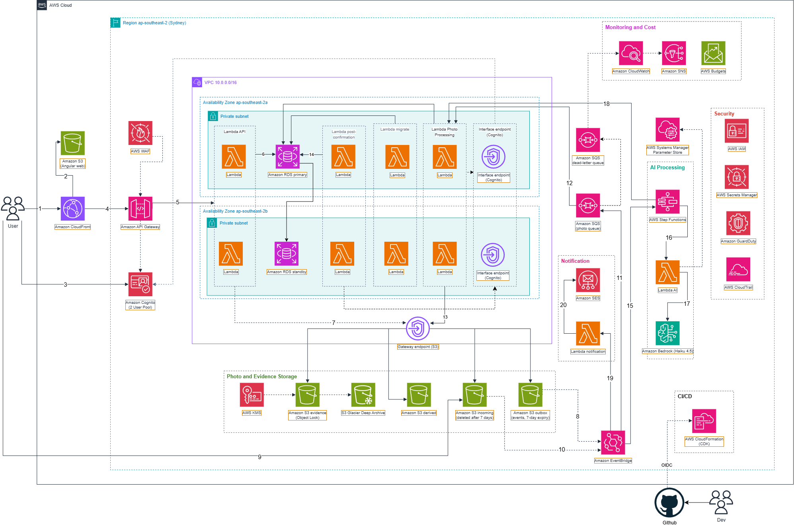

# RoomLedger

## Nền tảng serverless trên AWS quản lý nhà trọ, với biên bản ảnh không thể chỉnh sửa và AI đọc chỉ số điện nước

### 1. Tóm tắt điều hành

Ở các thành phố lớn tại Việt Nam, tranh chấp giữa chủ trọ và người thuê thường xoay quanh hai chuyện: tiền cọc khi trả phòng (phòng có bị hư hại không?) và hóa đơn điện nước hằng tháng (đồng hồ thật sự chỉ bao nhiêu?). Cả hai bên thường chỉ có thỏa thuận miệng hoặc vài tấm ảnh gửi qua chat.

RoomLedger là ứng dụng web serverless trên AWS, triển khai tại ap-southeast-2 (Sydney), có ba vai trò: quản trị viên, chủ trọ và người thuê. Quy mô là một nhà trọ 30–50 phòng, tức 31–51 người dùng hoạt động mỗi tháng (một chủ trọ và 30–50 người thuê), cộng thêm quản trị viên. Điểm khác biệt nằm ở hai tính năng: biên bản ảnh nhận phòng được khóa bằng Amazon S3 Object Lock sau khi hai bên cùng xác nhận, và Amazon Bedrock (Claude Haiku 4.5) đọc ảnh đồng hồ điện nước để lập hóa đơn hằng tháng. Hợp đồng giấy được chủ trọ scan, người thuê xác nhận, rồi được khóa theo cùng cách đó.

### 2. Tuyên bố vấn đề

### Vấn đề là gì?

Biên bản nhận phòng thường không có, hoặc chỉ là vài tấm ảnh rời rạc trong điện thoại mỗi người, nên khi trả phòng hai bên không có bằng chứng chung. Ảnh có thể bị cho là chụp sau, chụp phòng khác hoặc đã chỉnh sửa. Mỗi tháng chủ trọ tự ghi chỉ số, còn người thuê không thấy đồng hồ nên dễ nghi ngờ con số.

Các app quản lý nhà trọ trong nước (LOZIDO, Quản Lý Phòng Trọ Việt Nam) làm tốt hóa đơn, hợp đồng và nhắc thanh toán, nhưng không có biên bản bàn giao bằng ảnh và không dùng AI. Các app nước ngoài (Witnessed, PropCheckAI, DepositCam) có ghi ảnh bàn giao, nhưng không quản lý nhà trọ và không yêu cầu hai bên cùng xác nhận.

### Giải pháp

RoomLedger gộp biên bản ảnh được khóa và hai bên cùng xác nhận, AI đọc chỉ số đồng hồ và bước đối chiếu khi trả phòng vào một luồng duy nhất, cùng với hợp đồng, hóa đơn hằng tháng và quyết toán tiền cọc.

Ứng dụng web Angular được phục vụ từ Amazon S3 qua Amazon CloudFront. Người dùng đăng nhập bằng Amazon Cognito, và các lời gọi API đi qua Amazon API Gateway, được AWS WAF bảo vệ, tới AWS Lambda (.NET 8) chạy trong private subnet của Amazon VPC. Dữ liệu lưu trên Amazon RDS for PostgreSQL (Multi-AZ).

Ảnh được tải thẳng từ trình duyệt lên Amazon S3 kèm checksum SHA-256, đi qua Amazon EventBridge và Amazon SQS tới Lambda xử lý ảnh, và được sao chép sang bucket bằng chứng có Object Lock khi biên bản được khóa. Với ảnh đồng hồ, AWS Step Functions gọi Amazon Bedrock để đọc chỉ số; chủ trọ xác nhận và ứng dụng xuất hóa đơn. Khi trả phòng, chủ trọ xem song song ảnh nhận phòng và ảnh trả phòng của cùng một khu vực rồi nhập các khoản khấu trừ; người thuê chấp nhận hoặc khiếu nại từng khoản. AI không so sánh ảnh.

### Lợi ích và hoàn vốn đầu tư (ROI)

Chủ trọ và người thuê dùng chung một biên bản nhận phòng mà cả hai đã xác nhận và không ai sửa được, kể cả quản trị viên. Mỗi chỉ số điện nước đều có ảnh đồng hồ đi kèm, và hợp đồng giấy có bản scan do chủ trọ tải lên và người thuê xác nhận.

Lợi ích được đo trên dữ liệu demo bằng hai chỉ số:

- Thời gian ghi điện nước cho 10 phòng: đọc và nhập tay so với chụp ảnh rồi để AI đọc.
- Độ chính xác khi AI đọc đồng hồ trên bộ khoảng 30 ảnh đã biết chỉ số, báo cáo riêng cho đồng hồ cơ, đồng hồ điện tử và đồng hồ nước.

Môi trường production tốn khoảng 99,60 USD/tháng, tương đương 2,0–3,3 USD mỗi phòng mỗi tháng. Khoảng 91% là chi phí cố định theo giờ (RDS Multi-AZ, Interface endpoint, WAF), nên tăng từ 31 lên 51 người dùng hầu như không đổi hóa đơn. Không dùng NAT Gateway, lưu lượng S3 đi qua Gateway endpoint miễn phí, và AI chỉ dùng cho việc đọc đồng hồ với một model giá thấp.

Ứng dụng cho hai bên một cơ sở chung để thương lượng. Dự án không khẳng định biên bản có giá trị pháp lý trước tòa.

### 3. Kiến trúc giải pháp

RoomLedger dùng kiến trúc serverless trên AWS với một môi trường production duy nhất tại ap-southeast-2 (Sydney).

Lambda API và Lambda xử lý ảnh chạy trong private subnet trên hai Availability Zone, không có NAT Gateway. Chúng truy cập dịch vụ AWS qua VPC endpoint: Gateway endpoint cho S3, và Interface endpoint cho EventBridge (mỗi AZ một endpoint), Secrets Manager và Cognito (mỗi dịch vụ một endpoint ở một AZ, cả hai AZ đều truy cập được trong VPC). Chúng kết nối RDS qua TLS với xác thực IAM. Lambda AI và Lambda gửi thông báo chạy ngoài VPC nên không cần endpoint cho Bedrock hay SES.

Toàn bộ hạ tầng được viết bằng AWS CDK (C#) gồm 9 stack: Network, Security, Data, Storage, Auth, Api, Workflow, Observability và Edge.

### Các dịch vụ AWS sử dụng

- **Amazon CloudFront**: Phục vụ ứng dụng web Angular từ S3 và chuyển tiếp request API tới API Gateway.
- **AWS WAF**: Web ACL loại regional gắn vào stage của API Gateway, chặn lưu lượng bất thường và giới hạn tần suất request.
- **Amazon Cognito**: Hai user pool, một cho chủ trọ và người thuê, một cho quản trị viên với MFA bắt buộc.
- **Amazon API Gateway (REST API)**: Điểm vào API với Cognito authorizer.
- **AWS Lambda (.NET 8, ARM)**: API, xử lý ảnh, các hàm hệ thống (migrate, post-confirmation), AI đọc đồng hồ và gửi thông báo.
- **Amazon EventBridge**: Nối các bước bất đồng bộ (ảnh mới, khóa biên bản, đọc chỉ số, quyết toán, thông báo).
- **Amazon SQS**: Hàng đợi ảnh đứng trước Lambda xử lý ảnh cùng một dead-letter queue, hấp thụ lưu lượng tăng đột biến mà không mất sự kiện.
- **AWS Step Functions**: Điều phối việc đọc chỉ số: gọi Lambda AI, thử lại khi lỗi, rồi lưu kết quả.
- **Amazon Bedrock (Claude Haiku 4.5)**: Đọc chỉ số đồng hồ điện nước từ ảnh; đây là nơi duy nhất dùng AI.
- **Amazon S3 và S3 Glacier Deep Archive**: Ba bucket: incoming (xóa sau 7 ngày), derived (ảnh xem trước, PDF) và evidence (Object Lock ở chế độ Compliance, Intelligent-Tiering); ảnh bằng chứng của các hợp đồng đã kết thúc chuyển sang Glacier Deep Archive sau 30 ngày.
- **Amazon RDS for PostgreSQL**: db.t4g.micro Multi-AZ, 20 GB gp2, mã hóa, bắt buộc SSL, xác thực IAM.
- **Amazon VPC**: Private subnet ở hai AZ, Gateway endpoint cho S3, Interface endpoint cho EventBridge (2 AZ), Secrets Manager và Cognito; không có NAT Gateway.
- **AWS Systems Manager Parameter Store**: Cấu hình model AI, đổi được mà không cần deploy lại.
- **AWS IAM, AWS KMS và AWS Secrets Manager**: Mỗi Lambda một role với quyền tối thiểu; một khóa do khách hàng quản lý; mật khẩu master của database chỉ Lambda migrate đọc được.
- **Amazon GuardDuty và AWS CloudTrail**: Phát hiện mối đe dọa và lưu vết các lời gọi AWS API.
- **Amazon SES**: Gửi link mời, hóa đơn và thông báo.
- **Amazon CloudWatch, Amazon SNS và AWS Budgets**: Log, dashboard, cảnh báo gửi email qua SNS, và cảnh báo chi phí.
- **AWS CloudFormation (AWS CDK) và GitHub Actions (OIDC)**: Hạ tầng dưới dạng code, deploy mà không lưu AWS key.

### Thiết kế thành phần

- **Ứng dụng web**: Giao diện Angular cho ba vai trò; tính SHA-256 của file gốc trước khi tải lên S3.
- **Hợp đồng và biên bản nhận phòng**: Chủ trọ tải lên bản scan hợp đồng và ảnh hiện trạng; khi hai bên cùng xác nhận, biên bản được khóa và không ai sửa hay xóa được.
- **Điện nước và hóa đơn**: AI đọc chỉ số từ ảnh và đánh dấu các chỉ số không chắc chắn hoặc thấp hơn tháng trước; chủ trọ xác nhận và gửi hóa đơn.
- **Trả phòng**: Ảnh nhận phòng và trả phòng của cùng một khu vực được hiển thị song song; chủ trọ nhập khoản khấu trừ, người thuê chấp nhận hoặc khiếu nại từng khoản, sau đó ứng dụng quyết toán tiền cọc và xuất PDF thanh lý.
- **Phân quyền và nhật ký kiểm toán**: Mỗi chủ trọ chỉ thấy dữ liệu của mình và mỗi người thuê chỉ thấy phòng của mình; mọi thao tác và mọi lần truy cập bị từ chối đều được ghi vào nhật ký kiểm toán của ứng dụng trong database.
- **Dữ liệu**: EF Core code-first trên PostgreSQL; migration idempotent chạy qua Lambda migrate.

### 4. Triển khai kỹ thuật

**Các giai đoạn triển khai**

Dự án được xây dựng theo bốn giai đoạn trong năm tuần triển khai (Tuần 8–12):

- **Nền tảng** (Tuần 8): hạ tầng CDK (VPC hai AZ và các endpoint, RDS, ba bucket S3, hai Cognito user pool, API), CI/CD với OIDC, khung Angular cho ba vai trò, mô hình dữ liệu và phân quyền.
- **Hợp đồng, nhận phòng và hóa đơn** (Tuần 9–10): nhà trọ, phòng, link mời, scan hợp đồng, biên bản ảnh và khóa biên bản, AI đọc chỉ số và hóa đơn hằng tháng.
- **Trả phòng** (Tuần 11): đối chiếu ảnh song song, khấu trừ, khiếu nại, quyết toán tiền cọc, PDF thanh lý.
- **Hoàn thiện** (Tuần 12): kiểm thử bảo mật K1–K8, đánh giá AI đọc chỉ số, demo và workshop.

**Yêu cầu kỹ thuật**

- Frontend: Angular, Angular Material và WebCrypto; giao diện desktop cho chủ trọ và quản trị viên, giao diện mobile cho người thuê.
- Backend: .NET 8 trên Lambda: ASP.NET Core và EF Core (Npgsql) cho API; các Lambda riêng cho xử lý ảnh (Magick.NET chuyển HEIC sang JPEG, đọc EXIF), gọi Bedrock qua AWS SDK for .NET, và tạo PDF bằng QuestPDF.
- Hạ tầng: AWS CDK (C#), GitHub Actions với OIDC, một tài khoản AWS chung của nhóm tại ap-southeast-2 có cảnh báo AWS Budgets.
- Dữ liệu: ảnh nhận phòng và trả phòng của hai phòng thật, khoảng 30 ảnh đồng hồ (cơ, điện tử, nước) với chỉ số đã biết, và vài bản scan hợp đồng mẫu.

**Bộ kiểm thử bảo mật (K1–K8)**

- K1: Object trong bucket evidence không thể bị xóa hay ghi đè, kể cả khi dùng quyền quản trị viên.
- K2: File tải lên có checksum SHA-256 không khớp sẽ bị S3 từ chối.
- K3: Biên bản đã khóa không thể bị sửa hay xóa qua API với bất kỳ vai trò nào.
- K4: Biên bản chỉ được khóa khi cả chủ trọ và người thuê đã xác nhận.
- K5: Chủ trọ không thể đọc hay thay đổi nhà trọ, phòng hoặc biên bản của chủ trọ khác.
- K6: Người thuê không thể đọc hợp đồng, ảnh hoặc hóa đơn của phòng khác.
- K7: Rule giới hạn tần suất của WAF chặn được một đợt request dồn dập vào API.
- K8: Request không có token hợp lệ bị từ chối, và quản trị viên đăng nhập bắt buộc phải có MFA.

### 5. Lộ trình & Mốc triển khai

**Lộ trình dự án**

- Tuần 1–5: Học AWS (dịch vụ cốt lõi, serverless, bảo mật, IaC) và hoàn thành các workshop.
- Tuần 6–7: Vừa học vừa định hình ý tưởng: tìm hiểu vấn đề, so sánh các sản phẩm hiện có, thiết kế kiến trúc và giao diện, viết bản đề xuất.
- Tuần 8–12: Xây dựng dự án:
  - Tuần 8: Nền tảng; ảnh gốc tải lên S3 có kiểm tra checksum, cả ba vai trò đăng nhập được.
  - Tuần 9–10: Hợp đồng, nhận phòng và hóa đơn chạy trọn luồng.
  - Tuần 11: Trả phòng và quyết toán tiền cọc.
  - Tuần 12: Kiểm thử K1–K8, demo và báo cáo cuối kỳ.

### 6. Ước tính ngân sách

Chi phí được ước tính bằng AWS Pricing Calculator cho khu vực Asia Pacific (Sydney), production chạy 24/7 trên 2 AZ, 31–51 người dùng hoạt động mỗi tháng, theo giá trước chiết khấu (Before Discount).

### Chi phí hạ tầng

- Dịch vụ AWS:
  - Amazon RDS for PostgreSQL: $42.75/tháng (db.t4g.micro Multi-AZ 730 giờ $37.23, lưu trữ gp2 Multi-AZ 20 GB $5.52)
  - Amazon VPC: $37.96/tháng (4 Interface endpoint × 730 giờ: EventBridge ở 2 AZ, Secrets Manager và Cognito ở 1 AZ; xử lý 0,1 GB)
  - AWS WAF: $10.01/tháng (1 Web ACL $5.00, 5 rule $5.00, 20.000 request)
  - Amazon CloudWatch: $4.64/tháng (1 dashboard $3.00, 15 alarm $1.50, khoảng 0,2 GB log)
  - Amazon Bedrock (Claude Haiku 4.5): $1.49/tháng (token đầu vào $1.22, token đầu ra $0.27)
  - AWS KMS: $1.00/tháng (1 khóa do khách hàng quản lý, 400 request)
  - AWS Secrets Manager: $0.80/tháng (2 secret, 200 lời gọi API)
  - Amazon SQS: $0.26/tháng (650.000 request, chủ yếu do Lambda long-polling hàng đợi ảnh)
  - Amazon S3: $0.16/tháng (khoảng 8 GB, bucket evidence dùng Intelligent-Tiering)
  - Amazon CloudFront: $0.14/tháng (1 GB truyền dữ liệu, 20.000 request HTTPS)
  - Amazon GuardDuty: $0.14/tháng (6.000 sự kiện, 0,1 GB log)
  - Truyền dữ liệu: $0.14/tháng (1,2 GB ra internet)
  - AWS Lambda (ARM), API Gateway, SES, CloudTrail, EventBridge, SNS: $0.10/tháng (11.000 lời gọi API, 100 email)
  - AWS Step Functions, Systems Manager Parameter Store, Amazon Cognito: $0.00/tháng (nằm trong free tier; Cognito 31–51 MAU)

Tổng cộng: $99.60/tháng (cộng các dòng ra $99.59 do làm tròn), $1,195.20/12 tháng

### 7. Đánh giá rủi ro

#### Ma trận rủi ro

- Người thuê tải ảnh cũ hoặc ảnh phòng khác khi nhận phòng: ảnh hưởng cao, xác suất trung bình.
- AI đọc sai đồng hồ: ảnh hưởng trung bình, xác suất trung bình.
- Lỗi phân quyền giữa các chủ trọ: ảnh hưởng cao, xác suất thấp.
- Ảnh HEIC của iPhone không gửi thẳng được cho Bedrock: ảnh hưởng trung bình, xác suất cao.
- Model AI lỗi, bị throttle hoặc trả sai định dạng: ảnh hưởng trung bình, xác suất trung bình.
- Bản scan hợp đồng khác với bản giấy của người thuê: ảnh hưởng cao, xác suất thấp.
- Ảnh test và demo bị khóa ở chế độ Compliance nên không xóa được cho tới khi hết thời gian lưu giữ: ảnh hưởng thấp, xác suất cao.

#### Chiến lược giảm thiểu

- Ảnh cũ hoặc sai phòng: cảnh báo dựa trên ngày chụp trong EXIF; biên bản chỉ có hiệu lực khi hai bên cùng xác nhận.
- Chỉ số đồng hồ: luôn có người xác nhận; chỉ số không chắc chắn hoặc thấp hơn tháng trước được đánh dấu.
- Phân quyền: kiểm tra theo từng bản ghi trong API; được kiểm thử bởi K5 và K6.
- HEIC: Lambda xử lý ảnh chuyển sang JPEG để phân tích và giữ lại ảnh gốc.
- Model AI: đầu ra JSON được kiểm tra theo schema, có model dự phòng, và đổi model qua Parameter Store mà không cần deploy lại.
- Bản scan hợp đồng: người thuê phải xác nhận trước khi khóa và có thể bấm "Không đúng".
- Dữ liệu test bị khóa: thời gian lưu giữ là một tham số CDK; môi trường dev và demo dùng thời gian ngắn (ví dụ 1 ngày), production dùng thời gian lưu giữ đầy đủ.

#### Kế hoạch dự phòng

- Nếu Bedrock không ổn định lúc demo, việc đọc chỉ số chạy trên bộ ảnh demo cố định và chủ trọ nhập tay khi AI không đọc được.
- Nếu chi phí tăng bất thường, AWS Budgets cảnh báo để nhóm rà soát và giới hạn số lần gọi Bedrock.

### 8. Kết quả kỳ vọng

#### Cải tiến kỹ thuật

- Biên bản ảnh nhận phòng được khóa bằng S3 Object Lock và hai bên cùng xác nhận, được kiểm chứng bằng bộ kiểm thử K1–K8 cho khóa bằng chứng, phân quyền và WAF.
- AI đọc chỉ số đồng hồ thay cho ghi tay, kèm báo cáo độ chính xác và thời gian tiết kiệm được.

#### Giá trị dài hạn

- Một mẫu có thể tái sử dụng cho bằng chứng ảnh không thể chỉnh sửa trên AWS (tải lên có checksum, Object Lock, xác nhận hai bên, nhật ký kiểm toán), định nghĩa hoàn toàn bằng AWS CDK.
- Hướng phát triển: đối soát chuyển khoản ngân hàng, báo cáo sự cố bằng ảnh trong thời gian thuê, thông báo qua Zalo và ứng dụng mobile.
