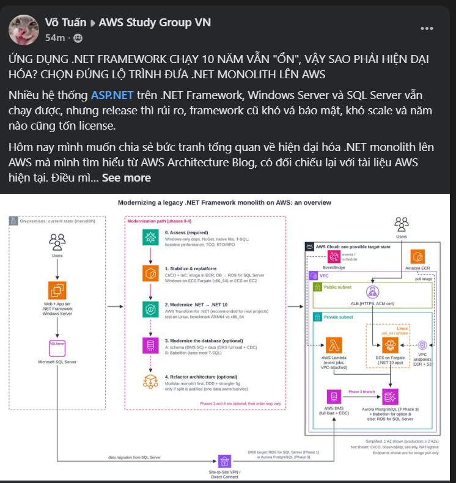
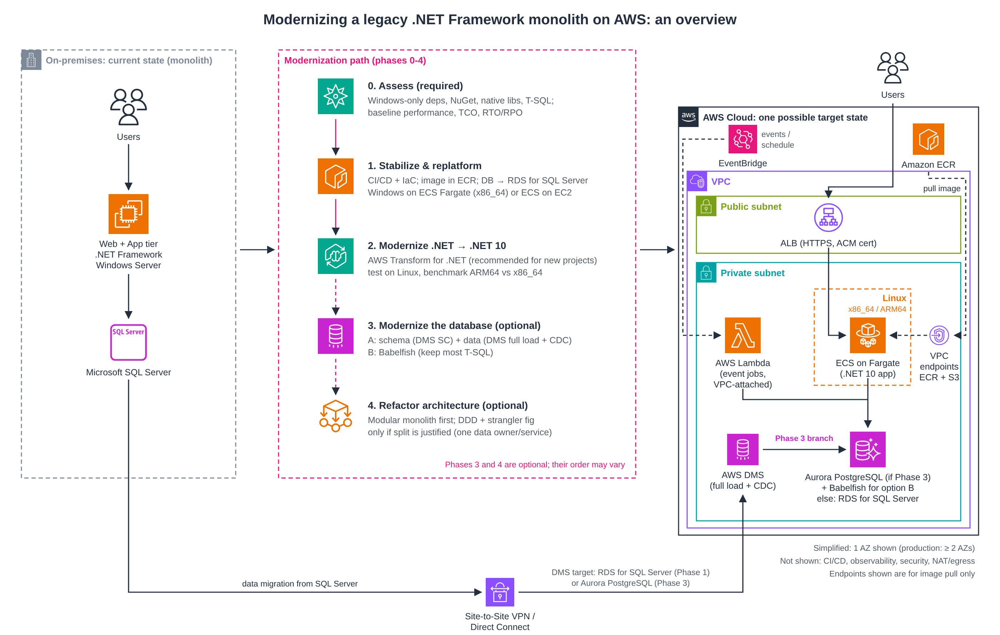

## A .NET FRAMEWORK APP HAS RUN "JUST FINE" FOR 10 YEARS, SO WHY MODERNIZE IT? CHOOSING THE RIGHT PATH TO MOVE A .NET MONOLITH TO AWS

> I also posted this article in the AWS Study Group (FCAJ) Facebook group: [view the post](https://www.facebook.com/groups/awsstudygroupfcj/posts/2332507414180884). The group is private, so only members can open the link.

Many companies still run ASP.NET applications written on .NET Framework, on Windows Server and Microsoft SQL Server. The application still works, but every release means the whole team is on call, newcomers need weeks to understand the code, the old framework is hard to patch and hard to hire for, the system is hard to scale, and Windows and SQL Server licenses have to be paid every year.

Today I want to share an overview of how to modernize a .NET monolith on AWS, which I learned from the AWS Architecture Blog, together with the recent AWS changes that I double-checked while writing. The thing I noticed most: **there is no single sequence of steps for every application**. Some phases are mandatory, some are prerequisites for other phases, and some should only be done when really needed.

**Note before reading:** the original article (published 19/05/2022) uses Microservice Extractor for .NET, App2Container and Porting Assistant for .NET. Since 07/11/2025, AWS has **stopped onboarding new customers** to these tools (existing customers can still use them to finish their projects) and introduced **AWS Transform for .NET** (an AI-agent service that converts .NET Framework code to cross-platform .NET) as the replacement. In this post I list both the tools from the original article and the current ones.

**Starting architecture:**

- `Web tier`: user interface (ASP.NET MVC or Web Forms).
- `Application tier`: business logic on `.NET Framework`, running on `Windows Server` + IIS.
- `Data tier`: `Microsoft SQL Server`.

**Phase 0: Assess (mandatory)**

- Inventory NuGet packages, native libraries and the parts that **only run on Windows**: Web Forms, WCF, COM/COM+, Windows Registry, Windows Authentication, IIS-specific configuration.
- Inventory stored procedures, triggers, SQL Server Agent jobs and the degree of T-SQL dependency.
- Analyze the business logic and how tightly the parts of the code are coupled.
- Measure the baseline: current performance, total cost of ownership (TCO), RTO/RPO requirements.
- Tools: the repository assessment feature of `AWS Transform for .NET` combined with a manual inventory.
- Output: an assessment report, a list of risks, and the decision on which phases to continue with.

**Phase 1: Stabilize and replatform**

- Set up CI/CD (build, scan, push the image to `Amazon ECR`, deploy, rollback) and manage infrastructure with IaC (CloudFormation, CDK or Terraform).
- Containerize the monolith. The original article uses `App2Container`, which no longer accepts new customers, so new projects write a Dockerfile.
- `Amazon ECR` is only where images are stored; containers run on `Amazon ECS`. If it is still .NET Framework, run **Windows containers** on `Amazon ECS on AWS Fargate` (ECS Fargate for short; supports Windows Server 2019/2022, x86_64 only, and does not support some features such as EFS, FSx, gMSA, Fargate Spot) or on `ECS on EC2` when you need those features or control over the host.
- The database can be moved to AWS **without changing the engine yet** (for example `Amazon RDS for SQL Server`), using `AWS DMS` (full load + CDC) or SQL Server native backup/restore.
- Turn on logging, monitoring, backup and basic security from this phase.
- Note: containerization only gives a **consistent deployment environment**; it does not solve technical debt. The application still depends on Windows, IIS and SQL Server.

**Phase 2: Modernize .NET**

- Port from .NET Framework to **.NET 10** (LTS release, published 11/2025, supported until 11/2028; .NET 8 ends support on 10/11/2026). The original article uses `Porting Assistant for .NET`. For new projects, AWS recommends `AWS Transform for .NET`, a new service that replaces the older group of tools rather than a renamed Porting Assistant. Transform still has limits on project types, and its results need human review and testing.
- Web Forms has no equivalent in ASP.NET Core. AWS Transform can port a Web Forms UI to **Blazor Server** (`.aspx`/`.ascx` become `.razor`, `Web.config` becomes `appsettings.json`), but this is **automation-assisted UI porting**, not an equivalent conversion: Web Forms uses the page lifecycle, PostBack and ViewState, while Blazor uses components. Third-party controls, `.svc` and `.ashx` files and Web Site projects still have to be handled manually, and UI behavior must be retested.
- Moving to .NET 10 **does not mean it will run on Linux**. Only drop Windows Server after replacing Windows-only APIs and running integration tests on Linux (including authentication, file system, timezone, encoding and certificates).
- `AWS Graviton` (ARM64) only applies to Linux containers (Windows containers do not run on Graviton; Fargate ARM64 needs platform version 1.4.0 or later). Graviton is worth considering to reduce cost, but not every native library has an ARM64 build. You need to build the image for the right architecture and benchmark against x86_64 first. The figure "Fargate Graviton2 is up to 20% cheaper" comes from the 2022 original article; for my own workload I need to recalculate with the AWS Pricing Calculator.
- Where to run: `ECS Fargate` for always-on applications, `AWS Lambda` for short jobs or event handling (in this post Lambda is not a public API).

**Phase 3: Modernize the database (optional)**

This is the riskiest phase. You can keep SQL Server (on RDS) if the conversion is not worth the effort. If you convert, there are two directions:

- **Direction A, move fully to PostgreSQL:** the target is `RDS for PostgreSQL` or `Aurora PostgreSQL`. This is not one automatic operation but 4 separate steps:
  1. **Convert the schema:** `AWS DMS Schema Conversion` (the AWS documentation recommends it instead of AWS SCT, which is now called the legacy version) converts the schema and database objects, with a list of action items to fix by hand. This step **does not move data**.
  2. **Migrate the data:** the data migration task of `AWS DMS` (full load, then CDC).
  3. **Fix and test the application:** adjust queries and drivers and re-check the business logic.
  4. **Cutover:** reconcile the data, check replication lag, pause writes (write freeze) and have a rollback plan.
- **AWS Transform** (since 12/2025) can also convert SQL Server to **Aurora PostgreSQL** (the only target of this workflow): schema, T-SQL stored procedures to PL/pgSQL, and ADO.NET/Entity Framework code. This workflow only supports .NET 6 and later applications and **does not support .NET Framework 4.x**, so Phase 2 must be finished first.
- **Direction B, Babelfish for Aurora PostgreSQL:** a compatibility layer that lets Aurora understand T-SQL and the SQL Server protocol, so less code needs to change. Babelfish is **not SQL Server running on PostgreSQL** and does not support all of T-SQL; you need to run `Babelfish Compass` and test with a real workload first.
- **Which direction?** With many stored procedures, heavy T-SQL dependency and code that is hard to change, consider Babelfish. With little T-SQL, code you can change and a wish to use standard PostgreSQL long term, choose Direction A.
- Being able to convert the syntax does not mean it runs correctly. Common differences: data types, collation and case sensitivity, identity and sequences, temporary tables, locking and transaction behavior, cross-database queries, SQL Server Agent jobs, and execution plans. DMS CDC only syncs data; the actual downtime also depends on the volume of changes, long transactions and replication lag. You need to reconcile data, benchmark performance, rehearse the cutover and have a rollback plan.

**Phase 4: Re-architect (optional)**

- Modernization **does not mean microservices**. Splitting services brings network latency, distributed transactions, eventual consistency, harder debugging and higher operating cost.
- A **modular monolith** (still deployed as one unit but divided into clear business modules) fits when the team is small and the business logic is not too complex. **Microservices** fit when clear bounded contexts exist, independent scaling or release is needed, and there is enough capability to operate a distributed system. Without a strong enough reason, stop at a modular monolith.
- If you split: use DDD to define business boundaries and split gradually in the strangler fig style. The original article uses `Microservice Extractor for .NET`; this tool has no direct replacement, because `AWS Transform for .NET` focuses on converting code to cross-platform .NET rather than splitting an application into services. Designing the boundaries is still the team's job.
- Also split **data ownership**: each service has its own schema and database user with permissions only on its own schema; other services get data through APIs or events. You also need a communication mechanism (for example SQS, EventBridge), retries, dead-letter queues and tracing.
- Phase 3 and Phase 4 can be swapped depending on how tightly the application is coupled to the database.

**A possible target architecture (after Phase 2; the database depends on Phase 3):**

- Users reach the app through an `Application Load Balancer` (HTTPS, certificate from `AWS Certificate Manager`) in a public subnet. The security group of the ECS tasks only accepts traffic from the ALB; add `AWS WAF` if the threat model requires it.
- The .NET 10 application runs on `ECS Fargate` in a private subnet. This can still be a monolith, a modular monolith or microservices, depending on Phase 4.
- Tasks pull images from `Amazon ECR` through the **ECR VPC endpoints (api, dkr) and the S3 endpoint** (S3 holds the image layers). These endpoints only serve image pulls. If you use CloudWatch Logs, Secrets Manager or KMS without NAT, you need the matching endpoints as well. Calling external APIs still needs a NAT Gateway or an outbound proxy.
- `AWS Lambda` runs short jobs triggered by `Amazon EventBridge` (event or schedule). EventBridge is not in the VPC; it calls Lambda through invoke permission. Lambda only needs to be **attached to the VPC** when it must reach private resources such as the database; then a security group must allow the connection to the database. If Lambda runs with high concurrency, use `RDS Proxy` or limit concurrency so it does not open too many connections. Attaching to a VPC also does not give Internet access by itself; you need NAT to call out.
- The database sits in a private subnet: `Amazon Aurora PostgreSQL` if you do Phase 3 (turn on Babelfish if you choose Direction B); if you skip Phase 3, keep `Amazon RDS for SQL Server` from Phase 1. The diagram shows the case where Phase 3 is done.
- `AWS DMS` runs in the VPC and connects to the on-premises SQL Server over **Site-to-Site VPN** or **Direct Connect**. The DMS target is `RDS for SQL Server` (Phase 1) or `Aurora PostgreSQL` (Phase 3). You need to check routes, firewalls and security groups to both the source and the target, and grant permission to read the transaction log for CDC.
- The simplified diagram only draws 1 AZ. In production: the ALB and ECS service span at least 2 AZs (with health checks, autoscaling and a deployment strategy), the database has a replica in another AZ for failover, and there are backups that have been tested by restoring. This is an overview diagram, not a production reference architecture.

**My summary table:**

| Phase | Mandatory? | Output / completion criteria | Main risk |
|---|---|---|---|
| 0. Assess | Mandatory | Assessment report, risk list, chosen phases | Skipping it puts the whole project at risk |
| 1. Stabilize + replatform | Recommended | Running on AWS with CI/CD, rollback, monitoring | Low; Windows containers are heavy, technical debt not reduced |
| 2. Modernize .NET | When you need to drop Windows or the old framework | Running .NET 10, passing integration tests on Linux (and ARM64 if Graviton is chosen) | Medium; Web Forms, WCF, Windows-only libraries |
| 3. Database | Optional | Reconciled data matches, performance meets baseline, rollback rehearsed | High; behavioral differences between SQL Server and PostgreSQL |
| 4. Re-architect | Optional | Services with clear boundaries and data owners | High; complexity of a distributed system |

**About cost:** moving to Linux can remove the Windows OS cost of the workload, but how much you save depends on how it runs. With Windows containers on Fargate, the Windows Server license is already included in the Fargate price (charged extra per vCPU), so I do not buy a separate license; with ECS on EC2 it depends on the instance's license model. The SQL Server cost only disappears when you really change the engine to PostgreSQL, and then Aurora/RDS, conversion, testing and operating costs appear. You should compare TCO before and after (compute, database, storage, network, monitoring, license, conversion effort) instead of looking only at licenses.

**Out of scope for this post** (each point is enough for its own post): detailed design of communication between services, a full testing strategy (characterization tests, regression, load tests), detailed cutover and rollback plans, and security and monitoring (WAF, Secrets Manager, KMS, CloudWatch, X-Ray, CloudTrail).

**What I learned:**

- Modernization is not "tear it down and rebuild", and it **does not require moving to microservices**. Many systems only need a replatform, or .NET 10 + a modular monolith, to solve most of their problems.
- Moving to a newer framework does not mean runtime compatibility: .NET 10 does not remove Windows dependencies by itself, and PostgreSQL is not automatically equivalent to SQL Server.
- Each phase needs **measurable completion criteria** instead of only expected benefits.
- The biggest lesson from writing this post: **an old blog post must be re-checked against current documentation**. The original was written in 2022; since then many tools have stopped accepting new customers, and the recommended .NET version and the schema conversion tool have both changed.

**Conclusion:**

Instead of a fixed 4-step sequence, start with assessment, stabilize the system on AWS, and only then modernize .NET, the database and the architecture when there is a clear reason. `AWS Transform for .NET` is an option worth evaluating for the code conversion part, after checking its supported scope, compatibility and cost. The diagram in this post is an overview picture for learning, not a complete production architecture.

**Personal perspective:** this post is my synthesis from several sources (the original AWS Architecture Blog article, AWS and Microsoft documentation) and the still-limited view of someone who is learning, so it surely has gaps. I would really appreciate feedback from everyone, especially those who have done .NET modernization in practice.

**References:**

- [AWS Architecture Blog – Modernization pathways for a legacy .NET Framework monolithic application on AWS](https://aws.amazon.com/blogs/architecture/modernization-pathways-for-a-legacy-net-framework-monolithic-application-on-aws/)
- [AWS Docs – AWS .NET Modernization Tools availability change](https://docs.aws.amazon.com/app2container/latest/UserGuide/dotnet-modernization-tools-availability-change.html)
- [AWS Docs – Modernizing .NET with AWS Transform](https://docs.aws.amazon.com/transform/latest/userguide/dotnet.html)
- [AWS News Blog – AWS Transform announces full-stack Windows modernization capabilities](https://aws.amazon.com/blogs/aws/aws-transform-announces-full-stack-windows-modernization-capabilities/)
- [AWS Prescriptive Guidance – Choosing an approach for modernizing .NET applications](https://docs.aws.amazon.com/prescriptive-guidance/latest/modernization-net-applications/welcome.html)
- [AWS Docs – AWS Transform: Porting UI layer code (Web Forms to Blazor)](https://docs.aws.amazon.com/transform/latest/userguide/dotnet-porting-ui.html)
- [AWS Docs – AWS Transform: SQL Server modernization](https://docs.aws.amazon.com/transform/latest/userguide/sql-server-modernization.html)
- [AWS Docs – DMS Schema Conversion and AWS SCT (legacy)](https://docs.aws.amazon.com/dms/latest/userguide/CHAP_GettingStarted.SCT.html)
- [AWS Docs – Babelfish for Aurora PostgreSQL](https://docs.aws.amazon.com/AmazonRDS/latest/AuroraUserGuide/babelfish.html)
- [AWS Prescriptive Guidance – Decomposing monoliths into microservices](https://docs.aws.amazon.com/prescriptive-guidance/latest/modernization-decomposing-monoliths/welcome.html)
- [Microsoft – .NET support policy](https://dotnet.microsoft.com/en-us/platform/support/policy)
- [AWS Docs – Windows containers on AWS Fargate](https://docs.aws.amazon.com/AmazonECS/latest/developerguide/windows-considerations.html)
- [AWS – AWS Fargate pricing](https://aws.amazon.com/fargate/pricing/)
- [AWS Docs – Amazon ECR interface VPC endpoints](https://docs.aws.amazon.com/AmazonECR/latest/userguide/vpc-endpoints.html)

#AWS #DotNET #Modernization #AWSTransform #ECS #Fargate #Aurora #AWSStudyGroupVN #FCAJ
