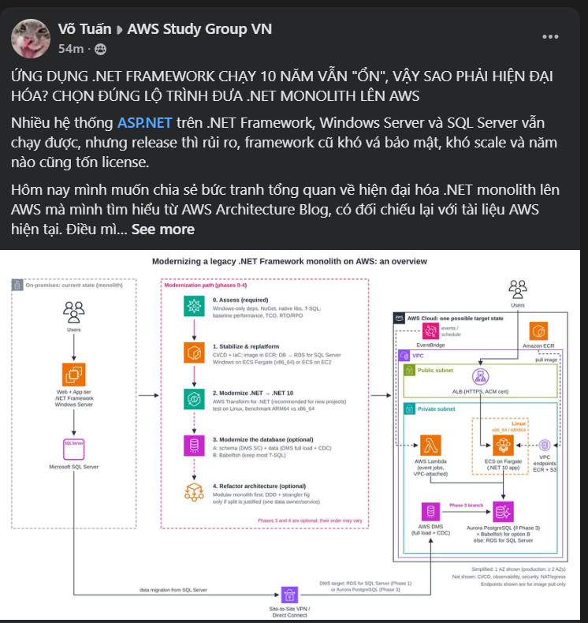
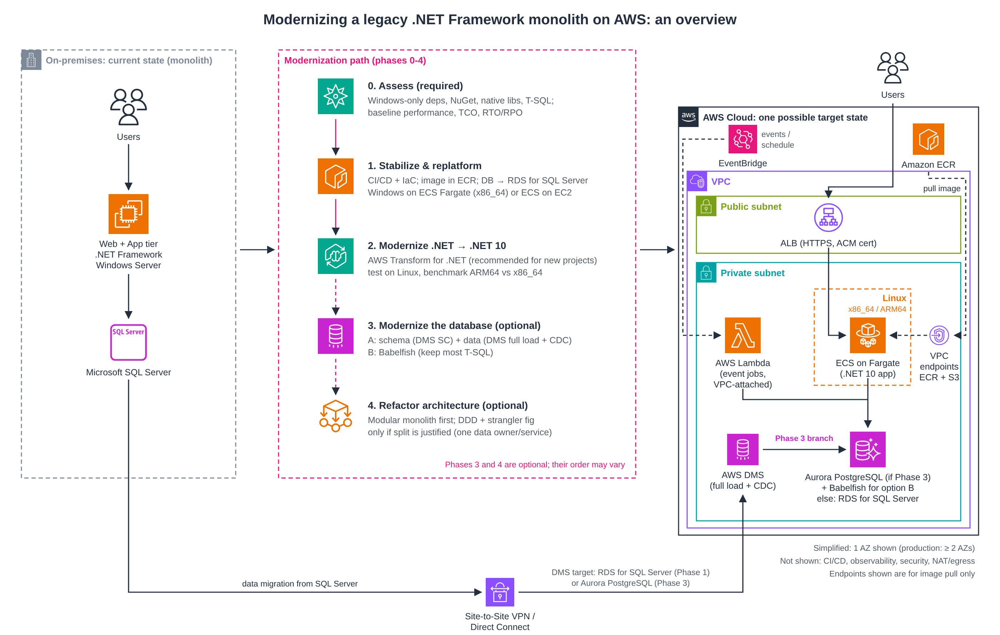

## ỨNG DỤNG .NET FRAMEWORK CHẠY 10 NĂM VẪN "ỔN", VẬY SAO PHẢI HIỆN ĐẠI HÓA? CHỌN ĐÚNG LỘ TRÌNH ĐƯA .NET MONOLITH LÊN AWS

> Bài viết này mình đã đăng trên group Facebook AWS Study Group (FCAJ): [xem bài đăng](https://www.facebook.com/groups/awsstudygroupfcj/posts/2333637697401189). Group ở chế độ riêng tư nên chỉ thành viên mới mở được link.

Rất nhiều doanh nghiệp vẫn đang vận hành ứng dụng ASP.NET viết trên .NET Framework, chạy trên Windows Server và Microsoft SQL Server. Ứng dụng vẫn chạy, nhưng mỗi lần release là một lần cả team phải "trực chiến", người mới vào mất hàng tuần để đọc hiểu code, framework cũ khó vá bảo mật và khó tuyển người, hệ thống khó scale, và năm nào cũng phải trả license Windows và SQL Server.

Hôm nay mình muốn chia sẻ bức tranh tổng quan về cách hiện đại hóa .NET monolith lên AWS mà mình tìm hiểu được từ AWS Architecture Blog, kèm theo những thay đổi mới của AWS mà mình kiểm tra lại khi viết bài. Điều mình thấy rõ nhất: **không có một chuỗi bước chung cho mọi ứng dụng**. Có phase bắt buộc, có phase là điều kiện của phase khác, và có phase chỉ nên làm khi thật sự cần.

**Lưu ý trước khi đọc:** bài gốc (đăng ngày 19/05/2022) dùng bộ công cụ Microservice Extractor for .NET, App2Container và Porting Assistant for .NET. Từ ngày 07/11/2025, AWS đã **ngừng nhận khách hàng mới** cho các công cụ này (khách hàng cũ vẫn dùng được để hoàn thành dự án) và giới thiệu **AWS Transform for .NET** (dịch vụ AI agent chuyển code .NET Framework sang .NET đa nền tảng) làm lựa chọn thay thế. Trong bài mình ghi cả công cụ của bài gốc lẫn công cụ hiện nay.

**Kiến trúc ban đầu:**

- `Web tier`: giao diện người dùng (ASP.NET MVC hoặc Web Forms).
- `Application tier`: logic nghiệp vụ trên `.NET Framework`, chạy trên `Windows Server` + IIS.
- `Data tier`: `Microsoft SQL Server`.

**Phase 0: Đánh giá (bắt buộc)**

- Kiểm kê NuGet package, thư viện native và các phần **chỉ chạy trên Windows**: Web Forms, WCF, COM/COM+, Windows Registry, Windows Authentication, cấu hình riêng của IIS.
- Kiểm kê stored procedure, trigger, SQL Server Agent job và mức độ phụ thuộc T-SQL.
- Phân tích nghiệp vụ và mức độ dính chặt giữa các phần trong code.
- Đo baseline: hiệu năng hiện tại, tổng chi phí sở hữu (TCO), yêu cầu RTO/RPO.
- Công cụ: tính năng đánh giá repo của `AWS Transform for .NET` kết hợp kiểm kê thủ công.
- Đầu ra: báo cáo đánh giá, danh sách rủi ro và quyết định đi tiếp những phase nào.

**Phase 1: Ổn định và replatform**

- Thiết lập CI/CD (build, scan, đẩy image lên `Amazon ECR`, deploy, rollback) và quản lý hạ tầng bằng IaC (CloudFormation, CDK hoặc Terraform).
- Container hóa monolith. Bài gốc dùng `App2Container`, công cụ này đã ngừng nhận khách hàng mới, nên dự án mới viết Dockerfile.
- `Amazon ECR` chỉ là nơi lưu image; container chạy trên `Amazon ECS`. Nếu vẫn là .NET Framework thì chạy **Windows container** trên `Amazon ECS on AWS Fargate` (gọi tắt là ECS Fargate; hỗ trợ Windows Server 2019/2022, chỉ chạy x86_64, không hỗ trợ một số tính năng như EFS, FSx, gMSA, Fargate Spot) hoặc trên `ECS on EC2` khi cần những tính năng đó hoặc cần kiểm soát host.
- Database có thể đưa lên AWS mà **chưa cần đổi engine** (ví dụ `Amazon RDS for SQL Server`), dùng `AWS DMS` (full load + CDC) hoặc backup/restore native của SQL Server.
- Bật logging, monitoring, backup và bảo mật cơ bản ngay từ phase này.
- Lưu ý: container hóa chỉ giúp **môi trường triển khai đồng nhất**, chưa giải quyết technical debt; ứng dụng vẫn phụ thuộc Windows, IIS và SQL Server.

**Phase 2: Hiện đại hóa .NET**

- Port từ .NET Framework lên **.NET 10** (bản LTS, phát hành 11/2025, hỗ trợ đến 11/2028; .NET 8 hết hỗ trợ ngày 10/11/2026). Bài gốc dùng `Porting Assistant for .NET`. Với dự án mới, AWS khuyến nghị `AWS Transform for .NET`, một dịch vụ mới thay cho nhóm công cụ cũ chứ không phải Porting Assistant đổi tên. Transform vẫn có giới hạn về loại project, và kết quả cần người review và kiểm thử.
- Web Forms không có bản tương đương trên ASP.NET Core. AWS Transform có thể port UI Web Forms sang **Blazor Server** (`.aspx`/`.ascx` thành `.razor`, `Web.config` thành `appsettings.json`), nhưng đây là **UI porting có hỗ trợ tự động**, không phải chuyển đổi tương đương: Web Forms dùng page lifecycle, PostBack, ViewState, còn Blazor dùng component. Control của bên thứ ba, file `.svc`, `.ashx` và Web Site project vẫn phải xử lý thủ công, và cần kiểm thử lại hành vi giao diện.
- Lên .NET 10 **chưa có nghĩa là chạy được trên Linux**. Chỉ bỏ Windows Server sau khi đã thay các API chỉ có trên Windows và chạy integration test trên Linux (cả xác thực, file system, timezone, encoding, certificate).
- `AWS Graviton` (ARM64) chỉ áp dụng cho container Linux (Windows container không chạy trên Graviton; Fargate ARM64 cần platform version 1.4.0 trở lên). Graviton đáng cân nhắc để giảm chi phí, nhưng không phải thư viện native nào cũng có bản ARM64. Cần build image đúng kiến trúc và benchmark với x86_64 trước. Con số "Fargate Graviton2 rẻ hơn tới 20%" là của bài gốc năm 2022; với workload của mình cần tính lại bằng AWS Pricing Calculator.
- Nơi chạy: `ECS Fargate` cho ứng dụng chạy liên tục, `AWS Lambda` cho job ngắn hoặc xử lý event (trong bài này Lambda không phải API public).

**Phase 3: Hiện đại hóa database (tùy chọn)**

Đây là phase rủi ro nhất. Có thể giữ SQL Server (trên RDS) nếu chuyển đổi không đáng công. Nếu chuyển, có hai hướng:

- **Hướng A, chuyển hẳn sang PostgreSQL:** target là `RDS for PostgreSQL` hoặc `Aurora PostgreSQL`. Đây không phải một thao tác tự động mà gồm 4 bước riêng:
  1. **Chuyển schema:** `AWS DMS Schema Conversion` (tài liệu AWS khuyến nghị dùng thay cho AWS SCT, nay được gọi là bản legacy) chuyển schema và database object, kèm danh sách action item cần sửa tay. Bước này **không chuyển dữ liệu**.
  2. **Chuyển dữ liệu:** tác vụ data migration của `AWS DMS` (full load rồi CDC).
  3. **Sửa và kiểm thử ứng dụng:** chỉnh query, driver và kiểm tra lại logic nghiệp vụ.
  4. **Cutover:** đối chiếu dữ liệu, kiểm tra replication lag, tạm dừng ghi (write freeze) và có kế hoạch rollback.
- **AWS Transform** (từ 12/2025) cũng chuyển được SQL Server sang **Aurora PostgreSQL** (target duy nhất của quy trình này): schema, stored procedure T-SQL sang PL/pgSQL, code ADO.NET/Entity Framework. Quy trình này chỉ hỗ trợ ứng dụng .NET 6 trở lên, **không hỗ trợ .NET Framework 4.x**, nên phải xong Phase 2 trước.
- **Hướng B, Babelfish for Aurora PostgreSQL:** lớp tương thích giúp Aurora hiểu T-SQL và giao thức SQL Server, nên sửa ít code hơn. Babelfish **không phải SQL Server chạy trên PostgreSQL** và không hỗ trợ toàn bộ T-SQL; cần chạy `Babelfish Compass` và kiểm thử với workload thật trước.
- **Chọn hướng nào?** Nhiều stored procedure, phụ thuộc T-SQL nặng, khó sửa code thì cân nhắc Babelfish. Ít T-SQL, sửa code được và muốn dùng PostgreSQL chuẩn lâu dài thì chọn hướng A.
- Chuyển được cú pháp chưa có nghĩa là chạy đúng. Khác biệt hay gặp: kiểu dữ liệu, collation và phân biệt hoa thường, identity và sequence, temporary table, cách lock và transaction, query xuyên database, SQL Server Agent job, và execution plan. DMS CDC chỉ đồng bộ dữ liệu; downtime thực tế còn phụ thuộc lượng thay đổi, transaction dài và replication lag. Cần đối chiếu dữ liệu, benchmark hiệu năng, diễn tập cutover và có kế hoạch rollback.

**Phase 4: Tái cấu trúc kiến trúc (tùy chọn)**

- Hiện đại hóa **không đồng nghĩa với microservices**. Tách service kéo theo độ trễ mạng, giao dịch phân tán, eventual consistency, khó debug và tốn chi phí vận hành hơn.
- **Modular monolith** (vẫn deploy một khối nhưng chia module rõ theo nghiệp vụ) phù hợp khi team nhỏ, nghiệp vụ chưa quá phức tạp. **Microservices** phù hợp khi đã có bounded context rõ, cần scale hoặc release độc lập và đủ năng lực vận hành hệ thống phân tán. Chưa có lý do đủ mạnh thì nên dừng ở modular monolith.
- Nếu tách: dùng DDD để xác định ranh giới nghiệp vụ, tách dần theo kiểu strangler fig. Bài gốc dùng `Microservice Extractor for .NET`; công cụ này không có bản thay thế trực tiếp, vì `AWS Transform for .NET` tập trung vào chuyển code sang .NET đa nền tảng chứ không tách ứng dụng thành service. Phần thiết kế ranh giới vẫn là việc của team.
- Tách cả **quyền sở hữu dữ liệu**: mỗi service một schema và một database user riêng, chỉ có quyền trên schema của mình; service khác lấy dữ liệu qua API hoặc event. Cần thêm cơ chế giao tiếp (ví dụ SQS, EventBridge), retry, dead-letter queue và tracing.
- Phase 3 và Phase 4 có thể đổi thứ tự tùy mức độ dính giữa ứng dụng và database.

**Một kiến trúc đích khả thi (sau Phase 2; database tùy Phase 3):**

- Người dùng truy cập qua `Application Load Balancer` (HTTPS, chứng chỉ từ `AWS Certificate Manager`) ở public subnet. Security group của task ECS chỉ nhận traffic từ ALB; thêm `AWS WAF` nếu threat model yêu cầu.
- Ứng dụng .NET 10 chạy trên `ECS Fargate` trong private subnet. Đây có thể vẫn là monolith, modular monolith hoặc microservices, tùy Phase 4.
- Task kéo image từ `Amazon ECR` qua **VPC endpoint của ECR (api, dkr) và S3** (S3 chứa các layer của image). Các endpoint này chỉ phục vụ việc kéo image. Nếu dùng CloudWatch Logs, Secrets Manager hay KMS mà không có NAT thì cần thêm endpoint tương ứng. Gọi API bên ngoài vẫn cần NAT Gateway hoặc proxy outbound.
- `AWS Lambda` chạy job ngắn do `Amazon EventBridge` kích hoạt (event hoặc lịch). EventBridge không nằm trong VPC, nó gọi Lambda qua quyền invoke. Lambda chỉ cần **gắn vào VPC** khi phải truy cập tài nguyên private như database; khi đó cần security group cho phép kết nối tới database. Nếu Lambda chạy song song nhiều, nên dùng `RDS Proxy` hoặc giới hạn concurrency để không mở quá nhiều connection. Gắn VPC cũng không tự có Internet; cần NAT nếu phải gọi ra ngoài.
- Database trong private subnet: `Amazon Aurora PostgreSQL` nếu làm Phase 3 (bật Babelfish nếu chọn hướng B); nếu không làm Phase 3 thì giữ `Amazon RDS for SQL Server` từ Phase 1. Sơ đồ vẽ trường hợp có làm Phase 3.
- `AWS DMS` chạy trong VPC, kết nối về SQL Server on-premises qua **Site-to-Site VPN** hoặc **Direct Connect**. Target của DMS là `RDS for SQL Server` (Phase 1) hoặc `Aurora PostgreSQL` (Phase 3). Cần kiểm tra route, firewall, security group tới cả nguồn và đích, và cấp quyền đọc transaction log cho CDC.
- Sơ đồ rút gọn chỉ vẽ 1 AZ. Khi chạy production: ALB và ECS service trải trên ít nhất 2 AZ (kèm health check, autoscaling, chiến lược deploy), database có replica ở AZ khác để failover, và có backup đã được thử restore. Đây là sơ đồ tổng quan, chưa phải production reference architecture.

**Bảng tổng hợp của mình:**

| Phase | Bắt buộc? | Đầu ra / tiêu chí hoàn thành | Rủi ro chính |
|---|---|---|---|
| 0. Đánh giá | Bắt buộc | Báo cáo đánh giá, danh sách rủi ro, chọn phase | Bỏ qua thì rủi ro cả dự án |
| 1. Ổn định + replatform | Nên làm | Chạy trên AWS, có CI/CD, rollback, monitoring | Thấp; Windows container nặng, chưa giảm technical debt |
| 2. Hiện đại hóa .NET | Khi cần bỏ Windows hoặc framework cũ | Chạy .NET 10, qua integration test trên Linux (và ARM64 nếu chọn Graviton) | Trung bình; Web Forms, WCF, thư viện chỉ có trên Windows |
| 3. Database | Tùy chọn | Dữ liệu đối chiếu khớp, hiệu năng đạt baseline, đã diễn tập rollback | Cao; khác biệt hành vi SQL Server và PostgreSQL |
| 4. Tái cấu trúc | Tùy chọn | Service có ranh giới và chủ sở hữu dữ liệu rõ | Cao; độ phức tạp của hệ thống phân tán |

**Về chi phí:** chuyển sang Linux có thể bỏ được phần chi phí Windows OS của workload, nhưng tiết kiệm bao nhiêu còn tùy cách chạy. Với Windows container trên Fargate, license Windows Server đã nằm trong giá Fargate (tính thêm theo vCPU), mình không phải tự mua license riêng; với ECS on EC2 thì tùy mô hình license của instance. Chi phí SQL Server chỉ mất đi khi thật sự đổi engine sang PostgreSQL, và khi đó lại phát sinh chi phí Aurora/RDS, chuyển đổi, kiểm thử và vận hành. Nên so sánh TCO trước và sau (compute, database, storage, network, monitoring, license, công chuyển đổi) thay vì chỉ nhìn license.

**Ngoài phạm vi bài này** (mỗi ý đủ cho một bài riêng): thiết kế chi tiết giao tiếp giữa các service, chiến lược kiểm thử đầy đủ (characterization test, regression, load test), kế hoạch cutover và rollback chi tiết, và bảo mật, giám sát (WAF, Secrets Manager, KMS, CloudWatch, X-Ray, CloudTrail).

**Điều mình rút ra:**

- Hiện đại hóa không phải là "đập đi xây lại" và **không bắt buộc lên microservices**. Nhiều hệ thống chỉ cần replatform, hoặc lên .NET 10 + modular monolith là đã giải quyết phần lớn vấn đề.
- Lên framework mới không đồng nghĩa với tương thích runtime: .NET 10 không tự bỏ được phụ thuộc Windows, PostgreSQL không tự tương đương SQL Server.
- Mỗi phase cần **tiêu chí hoàn thành đo được** thay vì chỉ kỳ vọng lợi ích.
- Bài học lớn nhất khi viết bài này: **bài blog cũ cần được kiểm tra lại với tài liệu hiện tại**. Bài gốc viết năm 2022, đến nay nhiều công cụ đã ngừng nhận khách hàng mới, phiên bản .NET khuyến nghị và công cụ chuyển schema đều đã thay đổi.

**Kết luận:**

Thay vì một chuỗi 4 bước cố định, hãy bắt đầu từ đánh giá, ổn định hệ thống trên AWS, rồi mới hiện đại hóa .NET, database và kiến trúc khi có lý do rõ ràng. `AWS Transform for .NET` là một lựa chọn đáng đánh giá cho phần chuyển code, sau khi đã kiểm tra phạm vi hỗ trợ, khả năng tương thích và chi phí. Sơ đồ trong bài là bức tranh tổng quan để học, không phải kiến trúc production hoàn chỉnh.

**Góc nhìn cá nhân:** bài viết được mình tổng hợp từ nhiều nguồn (bài gốc trên AWS Architecture Blog, tài liệu AWS và Microsoft) cùng góc nhìn còn hạn hẹp của một người đang học, nên chắc chắn còn thiếu sót. Mình rất mong nhận được góp ý từ mọi người, nhất là các anh chị đã từng làm hiện đại hóa .NET thực tế.

**Nguồn tham khảo:**

- [AWS Architecture Blog – Modernization pathways for a legacy .NET Framework monolithic application on AWS](https://aws.amazon.com/blogs/architecture/modernization-pathways-for-a-legacy-net-framework-monolithic-application-on-aws/)
- [AWS Docs – AWS .NET Modernization Tools availability change](https://docs.aws.amazon.com/app2container/latest/UserGuide/dotnet-modernization-tools-availability-change.html)
- [AWS Docs – Modernizing .NET with AWS Transform](https://docs.aws.amazon.com/transform/latest/userguide/dotnet.html)
- [AWS News Blog – AWS Transform announces full-stack Windows modernization capabilities](https://aws.amazon.com/blogs/aws/aws-transform-announces-full-stack-windows-modernization-capabilities/)
- [AWS Prescriptive Guidance – Choosing an approach for modernizing .NET applications](https://docs.aws.amazon.com/prescriptive-guidance/latest/modernization-net-applications/welcome.html)
- [AWS Docs – AWS Transform: Porting UI layer code (Web Forms sang Blazor)](https://docs.aws.amazon.com/transform/latest/userguide/dotnet-porting-ui.html)
- [AWS Docs – AWS Transform: SQL Server modernization](https://docs.aws.amazon.com/transform/latest/userguide/sql-server-modernization.html)
- [AWS Docs – DMS Schema Conversion và AWS SCT (legacy)](https://docs.aws.amazon.com/dms/latest/userguide/CHAP_GettingStarted.SCT.html)
- [AWS Docs – Babelfish for Aurora PostgreSQL](https://docs.aws.amazon.com/AmazonRDS/latest/AuroraUserGuide/babelfish.html)
- [AWS Prescriptive Guidance – Decomposing monoliths into microservices](https://docs.aws.amazon.com/prescriptive-guidance/latest/modernization-decomposing-monoliths/welcome.html)
- [Microsoft – .NET support policy](https://dotnet.microsoft.com/en-us/platform/support/policy)
- [AWS Docs – Windows containers trên AWS Fargate](https://docs.aws.amazon.com/AmazonECS/latest/developerguide/windows-considerations.html)
- [AWS – AWS Fargate pricing](https://aws.amazon.com/fargate/pricing/)
- [AWS Docs – Amazon ECR interface VPC endpoints](https://docs.aws.amazon.com/AmazonECR/latest/userguide/vpc-endpoints.html)

#AWS #DotNET #Modernization #AWSTransform #ECS #Fargate #Aurora #AWSStudyGroupVN #FCAJ
