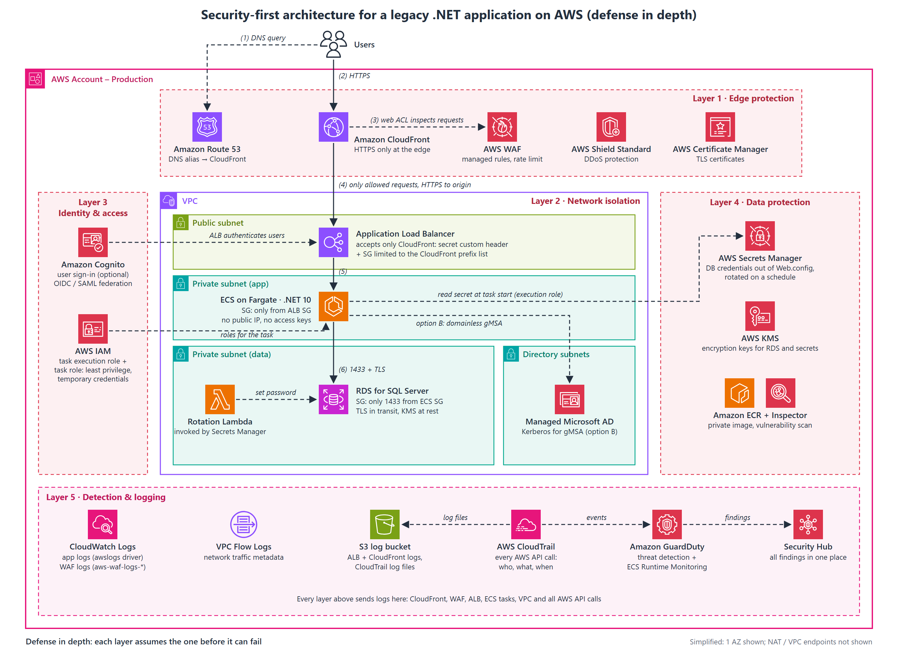

## IS THE CONNECTION STRING STILL IN WEB.CONFIG? SECURING A LEGACY .NET APPLICATION AFTER MOVING IT TO AWS

> I also posted this article in the AWS Study Group (FCAJ) Facebook group: [view the post](https://www.facebook.com/groups/awsstudygroupfcj/posts/2338886330209659). The group is private, so only members can open the link.

In Blog 1, I shared a path for modernizing a .NET monolith on AWS: assess, replatform, move to .NET 10, and only then think about the database and the architecture. But there is one question I did not answer: **once the application runs in containers, how does security change?**

On-premises, many old .NET applications are secured in a "the firewall is enough" way: the database password sits in `Web.config`, the application runs as an IIS app pool account, users sign in with Windows Authentication, and everything trusts everything else because it is all inside the internal network. On AWS, these assumptions no longer hold.

Today I want to share what I learned about securing the target architecture from Blog 1, split into 4 pillars: **secrets management, IAM roles, authentication, and network and data security**.

**Context: the application after Phase 2 of Blog 1**

- A .NET 10 application runs as a Linux container on `Amazon ECS on AWS Fargate` (ECS Fargate for short) in a private subnet.
- Users reach it through a domain name on `Amazon Route 53`, then `Amazon CloudFront`, and only then the `Application Load Balancer` (ALB) in a public subnet.
- The database is `Amazon RDS for SQL Server` (or Aurora PostgreSQL if Phase 3 is done).
- The original application uses on-premises Active Directory for sign-in and for the database connection.
- The application is still **a monolith** running as one ECS service. Throughout this post, the database connection has two options: **(A)** SQL Authentication with credentials in Secrets Manager (simpler), or **(B)** domainless gMSA with Active Directory (when the AD integration must be kept).

**Pillar 1: Secrets Management**

- `Web.config` or `appsettings.json` often holds a connection string with the user and password in plain text, and the file often gets committed to the repository. AWS Prescriptive Guidance also points this out as a common risk for .NET applications.
- You do not need to move the whole connection string to `AWS Secrets Manager`. The non-sensitive parts (server, database name, timeout) can stay in config; only the **credentials** (user, password, API key) go into Secrets Manager. Sensitive configuration that does not need rotation can use `Parameter Store` (SecureString).
- There are two ways for a container to get a secret on ECS:
  - **Declare it in the task definition** (`secrets` + `valueFrom`): ECS fetches the value and puts it into an environment variable when the task starts. Simple, no code change, but after the secret changes you have to start a new task to get the new value.
  - **The application reads it through the AWS SDK**, with the `AWSSDK.SecretsManager.Caching` library so it does not call the API on every request. This way can pick up the new value after rotation, but the application has to handle it: a sensible cache refresh time, opening new connections with the new credential (connections already open in the pool still use the old session), and retrying on temporary authentication errors during rotation.
- **Rotation is not on by default**; it has to be configured for the database and the authentication method:
  - RDS can let Secrets Manager manage the **master user password** and rotate it every 7 days by default. But the application should not use the master user.
  - The application's own user is rotated by a **rotation Lambda function**: Secrets Manager calls the Lambda on a schedule, the Lambda creates a new password, updates the user in the database, and then updates the new version of the secret in Secrets Manager. Secrets Manager does not change the database by itself. This Lambda runs inside the VPC so it can reach the database; choose the **single user** or **alternating users** strategy (switching between two users so connections do not drop when the password changes).
  - If the secret comes in through the task definition, you have to start new tasks after rotation (force new deployment); if it is only read once at startup, connections will fail. You should also monitor for failed rotations.
  - If the database connection uses Windows Authentication (see pillar 3), there is no database password to rotate; instead there is the secret of the AD account used to get the gMSA.

**Pillar 2: Identity & Access**

On ECS there are two roles that are very easy to confuse:

- **Task Execution Role**: used by the ECS/Fargate agent, **not by the application code**. This role pulls the image from `Amazon ECR`, writes logs to `CloudWatch Logs`, and fetches the secrets declared in the task definition. The container cannot use this role's permissions.
- **Task Role**: used by **the application code** when it calls AWS APIs at runtime, for example reading a file on S3, sending a message to SQS, or reading a secret through the SDK.
- Least privilege applies to each role separately: the execution role can only read that service's own secrets and repository; the task role only has the actions the application really needs, scoped to specific ARNs instead of `*`.
- For a monolith running as one ECS service, you only need **one minimal task role** for that workload. When it is split into several services (Phase 4 of Blog 1), each service gets its own task role, so if one service is compromised the blast radius is as small as possible. Compared with on-premises, where every application on the server shares the IIS app pool account, permissions are now tied to each workload.
- Do not put access keys in the container. ECS gives the task role temporary credentials and rotates them automatically.

**Pillar 3: Authentication**

There are two separate problems: **users signing in to the application**, and **the application authenticating to other systems** (database, file share).

- **Application users:** if the application is moved to OIDC/SAML sign-in, `Amazon Cognito` (user pool) is one option, not a required component. The ALB can authenticate through Cognito or OIDC before the request reaches the application, and Cognito can federate with AD FS or Microsoft Entra ID through SAML so employees keep using their company accounts. However, **Cognito does not directly replace Windows Authentication**: it does not issue Kerberos tickets and does not work with gMSA or NTFS permissions. Also, the ALB only authenticates at the HTTP layer and passes the user information (claims) down; the application still has to read the claims, map roles/groups and do its own business authorization.
- **Workloads that need Active Directory:** `AWS Managed Microsoft AD` (AWS Directory Service) fits better when the application needs Kerberos, gMSA, or Windows Authentication to SQL Server. `RDS for SQL Server` supports Windows Authentication with **AWS Managed Microsoft AD**, or joining a **self-managed AD** directly (including on-premises AD if there is network connectivity, supported since 07/2023). Another way to keep on-premises identities is to use AWS Managed Microsoft AD with a **forest trust** to the on-premises AD. `AD Connector` is **not** a supported option for this feature. This post uses AWS Managed Microsoft AD as the example, but it is not the only option.
- **gMSA in containers:** a gMSA (group Managed Service Account) gives the application an AD identity without embedding a static password.
  - Windows containers on ECS Fargate **do not support gMSA**; if you need it, use ECS on EC2 (as Blog 1 mentioned).
  - Since 03/2024, ECS Fargate supports **domainless gMSA** for **Linux** containers through the built-in **Credentials Fetcher** (the task does not join the domain). This is **one option** to keep the AD integration after moving to .NET 10 on Linux, not something you just switch on. The main requirements:
    - Fargate platform version 1.4.0 or later; each task can only use one Active Directory.
    - The CredSpec file is stored on S3; the AD account used to get the gMSA (username, password, domainName) is stored in Secrets Manager.
    - The task execution role can read exactly that secret and that CredSpec object (plus KMS permissions if the secret is encrypted with a customer-managed key).
    - The VPC can resolve the AD domain name (DHCP options pointing to the AD DNS) and the task can reach the domain controllers.
    - The connection string uses the SQL Server **FQDN** that matches the registered SPN, not an IP address; DNS, the Kerberos realm and time sync must be correct. On Linux, do not count on a fallback to NTLM like on Windows.
    - You need real testing with the .NET version, `Microsoft.Data.SqlClient` and the RDS SQL Server version you use.
- **Two different identities:** Cognito authenticates **users**; gMSA (or a SQL credential) authenticates **the workload** when it connects to the database. A gMSA is not the identity of each user signed in to the website; passing the end user's identity down to the database is a separate Kerberos delegation problem.

**Pillar 4: Network & Data Security**

- **The edge layer:** `Amazon CloudFront` sits in front of the ALB and receives HTTPS requests at the edge location closest to the user. An `AWS WAF` web ACL is attached to the CloudFront distribution, so requests are filtered at the edge before they reach the VPC: managed rules (SQL injection, XSS, bad IPs) and a rate-based rule against request flooding. CloudFront and Route 53 are protected by `AWS Shield Standard` against common network-layer DDoS attacks by default, at no extra cost. WAF **only protects at the HTTP request layer**; it does not replace authentication, IAM or security groups.
- **Only let CloudFront reach the ALB:** otherwise users can still call the ALB directly and skip WAF. Following the CloudFront documentation, CloudFront adds a **secret custom header** to requests it sends to the origin, the ALB listener only forwards requests that carry that header (others get a 403), and the ALB security group only allows the **AWS-managed prefix list for CloudFront**. Another option is **CloudFront VPC origins**, which lets you place an internal ALB in a private subnet.
- **Security groups are chained**, referencing each other instead of opening IP ranges:
  - ALB SG: only accepts 443 from the CloudFront prefix list.
  - ECS task SG: only accepts the application port from the ALB SG.
  - Database SG: only accepts 1433 (SQL Server) from the ECS task SG.
  - If you choose option B (gMSA): the task also needs a path to AWS Managed Microsoft AD (DNS, Kerberos, LDAP as listed in the Directory Service docs), or to on-premises AD over VPN/Direct Connect.
  - Tasks in the private subnet get secrets from Secrets Manager and the CredSpec from S3 through VPC endpoints or NAT.
- **Encryption in transit:** HTTPS from users to CloudFront and from CloudFront to the ALB, with certificates from `AWS Certificate Manager` (ACM); the CloudFront certificate must be created in `us-east-1`, and the ALB certificate in the ALB's Region; the connection to SQL Server uses TLS (`Encrypt=True` in the connection string, and it can be enforced with the `rds.force_ssl` parameter). The Linux container must trust the RDS CA certificate (add the RDS CA bundle to the image) for the TLS connection to work.
- **Encryption at rest:** RDS encrypts the database, backups and snapshots with a KMS key; Secrets Manager encrypts secrets with a KMS key (`AWS KMS` manages the keys, it does not store the data). Choose a customer-managed key when you need to control the key policy, key rotation or audit key usage. Note: RDS encryption must be turned on **when the instance is created**; for an existing unencrypted instance you have to copy a snapshot with encryption and restore it.

**Alongside the 4 pillars: logging & monitoring**

Security without logs means that when something goes wrong, you cannot tell what happened. These are the log sources and monitoring services I think should be turned on from the start:

- `AWS CloudTrail` records every AWS API call: who called what, when and from where. Create a trail that delivers logs to S3 so they are kept long-term for audits.
- `CloudWatch Logs` receives application logs from containers through the `awslogs` log driver. Set a retention period for each log group, and never write secrets or connection strings to logs.
- Request-layer logs: WAF logs go to CloudWatch Logs (the log group name must start with `aws-waf-logs-`), S3 or Firehose; ALB access logs and CloudFront logs go to S3. `VPC Flow Logs` record metadata about network traffic in the VPC.
- `Amazon GuardDuty` detects threats by analyzing CloudTrail, VPC flow logs and DNS logs; its **Runtime Monitoring** feature also supports ECS on Fargate to watch behavior inside containers.
- `AWS Security Hub` collects findings from GuardDuty, Inspector and other services in one place, and checks configuration against best-practice standards.

**The architecture after applying the 4 pillars:**

- (1) Users open the application domain (for example `app.example.com`); `Amazon Route 53` resolves it through an alias record that points to the CloudFront distribution.
- (2) Users send HTTPS requests to the nearest CloudFront edge location. (3) The WAF web ACL attached to CloudFront filters them, and Shield Standard protects against network-layer DDoS.
- (4) CloudFront forwards only allowed requests to the ALB over HTTPS, with the custom header; the ALB only accepts traffic from CloudFront. If the application uses OIDC/SAML, the ALB sends users to Cognito to sign in.
- (5) The ALB forwards requests to the ECS Fargate task in the private subnet (its SG only accepts traffic from the ALB). (6) The task connects to the database as described below.
- When the task starts, the execution role pulls the image from ECR, fetches secrets from Secrets Manager and writes logs to CloudWatch Logs. At runtime, the application code uses the task role to call other AWS APIs (S3, SQS...). With option B, the execution role also reads the CredSpec from S3 and the AD account from Secrets Manager so Credentials Fetcher can get the gMSA Kerberos ticket from the domain controller.
- The task connects to RDS for SQL Server over TLS in one of two ways: **(A)** a user/password from Secrets Manager, or **(B)** Windows Authentication through domainless gMSA with AWS Managed Microsoft AD (the task needs a path to AD).
- RDS and Secrets Manager encrypt data with KMS keys. If a user/password is used and rotation is configured, Secrets Manager calls the rotation Lambda on a schedule to change the password in the database and update the secret.
- AWS Managed Microsoft AD is a shared directory service in the VPC, placed in its own subnets rather than belonging to the database. By default it runs two domain controllers in two AZs; production needs to plan for the availability of the directory.
- The whole system is logged and monitored: CloudTrail writes API calls to S3, application and WAF logs go to CloudWatch Logs, ALB and CloudFront logs go to S3; GuardDuty analyzes these sources to detect anomalies and sends findings to Security Hub.

**My summary table (before and after):**

| Pillar | On-premises (before) | On AWS (after) |
|---|---|---|
| 1. Secrets | Plain-text password in `Web.config` | Credentials in Secrets Manager, rotated if configured |
| 2. Access | IIS app pool account shared on the server | Execution role + minimal task role per workload |
| 3a. User sign-in | Windows Integrated Authentication | OIDC/SAML federation (for example Cognito + the company IdP), if the application is converted |
| 3b. Application to database | AD service account | SQL credential from Secrets Manager (A) or domainless gMSA (B), depending on compatibility needs |
| 4. Network and data | Trust the internal network, perimeter firewall | CloudFront + WAF + Shield at the edge, ALB only reachable from CloudFront, chained security groups, TLS, KMS |
| Logging and monitoring | Logs scattered across servers | CloudTrail, CloudWatch Logs, WAF/ALB/CloudFront logs, GuardDuty, Security Hub |

**Out of scope for this post:** software supply chain security (image vulnerability scanning and image signing in the pipeline), managing the team's access to AWS accounts (`IAM Identity Center`), and service-to-service security after splitting into microservices.

**What I learned:**

- Moving to AWS does not make an application more secure by itself. I have to actively replace the old assumptions ("same network means trusted") with clear authentication and authorization at every layer.
- Many services are easy to see as "replacements" for each other, but each one solves its own problem: Cognito authenticates users while gMSA authenticates the workload, WAF does not replace security groups, and the execution role is not the task role.
- "Having rotation" only means something when the application can read the new secret. A security feature only works when both the application and the infrastructure support it.

**Conclusion:**

For a legacy .NET application, security on AWS starts with taking credentials out of configuration files, granting least privilege through IAM roles, and choosing the right authentication for users and for the workload, and only then adding the network and encryption layers. These four pillars should be considered from Phase 1 of the modernization path, instead of after the system is already in production.

**Personal perspective:** this post is my synthesis from several sources (AWS Prescriptive Guidance, the AWS Containers Blog, the AWS Security Blog and AWS documentation) and the still-limited view of someone who is learning, so it surely has gaps. I would really appreciate feedback from everyone, especially those who have secured .NET applications on AWS in practice.

**References:**

- [AWS Prescriptive Guidance – Security best practices for modernizing .NET Framework applications on AWS (PDF, section Secrets management)](https://docs.aws.amazon.com/pdfs/prescriptive-guidance/latest/modernization-net-applications-security/modernization-net-applications-security.pdf)
- [AWS Docs – Amazon ECS task execution IAM role](https://docs.aws.amazon.com/AmazonECS/latest/developerguide/task_execution_IAM_role.html)
- [AWS Docs – Best practices for IAM roles in Amazon ECS](https://docs.aws.amazon.com/AmazonECS/latest/developerguide/security-iam-roles.html)
- [AWS Docs – Password management with Amazon RDS and AWS Secrets Manager](https://docs.aws.amazon.com/AmazonRDS/latest/UserGuide/rds-secrets-manager.html)
- [AWS Docs – Using gMSA for Linux containers on Fargate](https://docs.aws.amazon.com/AmazonECS/latest/developerguide/fargate-linux-gmsa.html)
- [AWS Docs – Working with Active Directory with RDS for SQL Server](https://docs.aws.amazon.com/AmazonRDS/latest/UserGuide/User.SQLServer.ActiveDirectoryWindowsAuth.html)
- [AWS Docs – Windows Authentication for Amazon RDS for SQL Server (AWS Managed Microsoft AD)](https://docs.aws.amazon.com/AmazonRDS/latest/UserGuide/USER_SQLServerWinAuth.html)
- [AWS Docs – Authenticate users using an Application Load Balancer](https://docs.aws.amazon.com/elasticloadbalancing/latest/application/listener-authenticate-users.html)
- [Microsoft Learn – SQL Server authentication with Microsoft.Data.SqlClient](https://learn.microsoft.com/en-us/sql/connect/ado-net/sql/authentication-sql-server)
- [AWS Containers Blog – Windows Authentication with gMSA on Linux containers on Amazon ECS with AWS Fargate](https://aws.amazon.com/blogs/containers/windows-authentication-with-gmsa-on-linux-containers-on-amazon-ecs-with-aws-fargate)
- [AWS Security Blog – How AWS Managed Microsoft AD helps to simplify the deployment and improve the security of Active Directory–integrated .NET applications](https://aws.amazon.com/blogs/security/how-aws-managed-microsoft-ad-helps-to-simplify-the-deployment-and-improve-the-security-of-active-directory-integrated-net-applications)
- [AWS Docs – Amazon ECS Windows containers on AWS Fargate considerations](https://docs.aws.amazon.com/AmazonECS/latest/developerguide/windows-considerations.html)
- [AWS Docs – Route traffic to a CloudFront distribution by using your domain name (Route 53)](https://docs.aws.amazon.com/Route53/latest/DeveloperGuide/routing-to-cloudfront-distribution.html)
- [AWS Docs – Use AWS WAF protections with CloudFront](https://docs.aws.amazon.com/AmazonCloudFront/latest/DeveloperGuide/distribution-web-awswaf.html)
- [AWS Docs – Restrict access to Application Load Balancers (CloudFront)](https://docs.aws.amazon.com/AmazonCloudFront/latest/DeveloperGuide/restrict-access-to-load-balancer.html)
- [AWS Docs – Restrict access with CloudFront VPC origins](https://docs.aws.amazon.com/AmazonCloudFront/latest/DeveloperGuide/private-content-vpc-origins.html)
- [AWS Docs – AWS Shield Standard](https://docs.aws.amazon.com/waf/latest/developerguide/ddos-standard-summary.html)
- [AWS Docs – Logging AWS WAF protection pack (web ACL) traffic](https://docs.aws.amazon.com/waf/latest/developerguide/logging.html)
- [AWS Docs – Access logs for your Application Load Balancer](https://docs.aws.amazon.com/elasticloadbalancing/latest/application/enable-access-logging.html)
- [AWS Docs – Send Amazon ECS logs to CloudWatch (awslogs)](https://docs.aws.amazon.com/AmazonECS/latest/developerguide/using_awslogs.html)
- [AWS Docs – What is AWS CloudTrail?](https://docs.aws.amazon.com/awscloudtrail/latest/userguide/cloudtrail-user-guide.html)
- [AWS Docs – GuardDuty Runtime Monitoring](https://docs.aws.amazon.com/guardduty/latest/ug/runtime-monitoring.html)
- [AWS Docs – What is AWS Security Hub?](https://docs.aws.amazon.com/securityhub/latest/userguide/what-is-securityhub.html)
- [AWS Well-Architected – Security Pillar](https://docs.aws.amazon.com/wellarchitected/latest/security-pillar/welcome.html)

**Hands-on workshops on First Cloud Journey (FCJ):**

- [Credentials Management with AWS Secrets Manager](https://000096.awsfcaj.com)
- [Application Protection with AWS WAF](https://000026.awsfcaj.com)
- [Encryption with AWS Key Management Service](https://000033.awsfcaj.com)
- [Cross-Domain Authentication with Amazon Cognito](https://000141.awsfcaj.com)
- [Containerization with Amazon ECS and AWS Fargate](https://000067.awsfcaj.com)

#AWS #DotNET #Security #SecretsManager #IAM #ActiveDirectory #WAF #AWSStudyGroupVN #FCAJ
