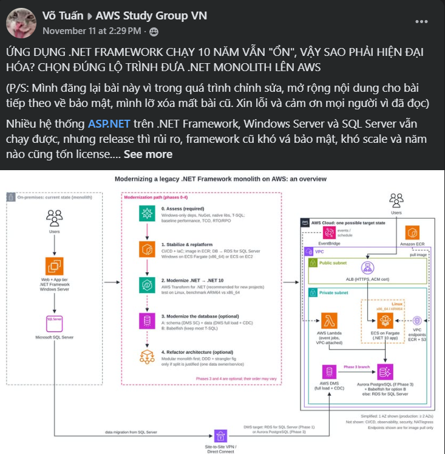
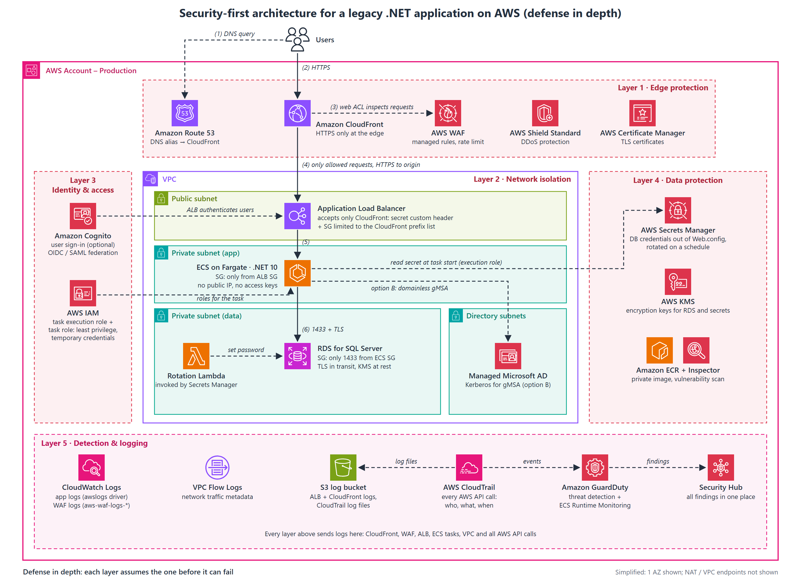

## CONNECTION STRING VẪN NẰM TRONG WEB.CONFIG? BẢO MẬT ỨNG DỤNG .NET LEGACY SAU KHI ĐƯA LÊN AWS

> Bài viết này mình đã đăng trên group Facebook AWS Study Group (FCAJ): [xem bài đăng](https://www.facebook.com/groups/awsstudygroupfcj/posts/2338886330209659). Group ở chế độ riêng tư nên chỉ thành viên mới mở được link.

Ở Blog 1, mình đã chia sẻ lộ trình hiện đại hóa một .NET monolith lên AWS: đánh giá, replatform, lên .NET 10, rồi mới tính đến database và kiến trúc. Nhưng có một câu hỏi mình chưa trả lời: **ứng dụng chạy trên container rồi thì bảo mật thay đổi thế nào?**

Trên on-premises, nhiều ứng dụng .NET cũ bảo mật theo kiểu "có tường lửa là đủ": mật khẩu database nằm trong `Web.config`, ứng dụng chạy bằng tài khoản IIS app pool, người dùng đăng nhập bằng Windows Authentication, và mọi thứ tin nhau vì cùng nằm trong mạng nội bộ. Khi lên AWS, những giả định này không còn đúng.

Hôm nay mình muốn chia sẻ những gì mình tìm hiểu được về bảo mật cho kiến trúc đích ở Blog 1, chia thành 4 trụ cột: **quản lý secret, IAM role, xác thực, bảo mật mạng và dữ liệu**.

**Bối cảnh: ứng dụng sau Phase 2 của Blog 1**

- Ứng dụng .NET 10 chạy container Linux trên `Amazon ECS on AWS Fargate` (gọi tắt là ECS Fargate) trong private subnet.
- Người dùng truy cập qua tên miền trên `Amazon Route 53`, đi qua `Amazon CloudFront` rồi mới tới `Application Load Balancer` (ALB) ở public subnet.
- Database là `Amazon RDS for SQL Server` (hoặc Aurora PostgreSQL nếu đã làm Phase 3).
- Ứng dụng gốc dùng Active Directory on-premises cho đăng nhập và cho kết nối database.
- Ứng dụng vẫn là **một monolith** chạy như một ECS service. Xuyên suốt bài, kết nối database có hai lựa chọn: **(A)** SQL Authentication với credentials trong Secrets Manager (đơn giản hơn), hoặc **(B)** domainless gMSA với Active Directory (khi cần giữ tích hợp AD).

**Trụ cột 1: Quản lý secret (Secrets Management)**

- `Web.config` hay `appsettings.json` thường chứa connection string có user và password dạng plain text, và file này hay bị commit lên repository. AWS Prescriptive Guidance cũng chỉ ra đây là rủi ro phổ biến của ứng dụng .NET.
- Không cần chuyển cả connection string sang `AWS Secrets Manager`. Phần không nhạy cảm (server, database name, timeout) vẫn để trong config; chỉ **credentials** (user, password, API key) mới đưa vào Secrets Manager. Cấu hình nhạy cảm nhưng không cần xoay vòng có thể dùng `Parameter Store` (SecureString).
- Có hai cách để container lấy secret trên ECS:
  - **Khai báo trong task definition** (`secrets` + `valueFrom`): ECS lấy giá trị và đưa vào biến môi trường lúc task khởi động. Đơn giản, không phải sửa code, nhưng đổi secret xong phải chạy lại task mới nhận giá trị mới.
  - **Ứng dụng tự đọc qua AWS SDK**, kèm thư viện cache `AWSSDK.SecretsManager.Caching` để không gọi API mỗi request. Cách này có thể nhận giá trị mới sau khi xoay vòng, nhưng ứng dụng phải tự lo: cache có thời gian làm mới hợp lý, mở kết nối mới bằng credential mới (connection đang mở trong pool vẫn dùng phiên cũ), retry khi gặp lỗi xác thực tạm thời lúc đang xoay vòng.
- **Rotation không tự động có sẵn**, phải cấu hình phù hợp với database và cách xác thực:
  - RDS có thể để Secrets Manager quản lý **master user password** và xoay vòng mặc định 7 ngày. Nhưng ứng dụng không nên dùng master user.
  - User riêng của ứng dụng xoay vòng bằng **hàm Lambda rotation**: Secrets Manager gọi Lambda theo lịch, Lambda tạo mật khẩu mới, cập nhật user trong database rồi cập nhật version mới của secret trong Secrets Manager. Secrets Manager không tự sửa database. Lambda này chạy trong VPC để kết nối được database; chọn chiến lược **single user** hoặc **alternating users** (luân phiên hai user để không bị rớt kết nối khi đổi mật khẩu).
  - Nếu secret được đưa vào qua task definition thì sau khi xoay vòng phải chạy task mới (force new deployment); nếu chỉ đọc một lần lúc khởi động thì sẽ lỗi kết nối. Nên giám sát cả trường hợp rotation thất bại.
  - Nếu kết nối database bằng Windows Authentication (xem trụ cột 3) thì không có password database để xoay vòng; thay vào đó là secret của tài khoản AD dùng để lấy gMSA.

**Trụ cột 2: Danh tính và quyền truy cập (Identity & Access)**

Trên ECS có hai role rất dễ nhầm:

- **Task Execution Role**: do ECS/Fargate agent dùng, **không phải code ứng dụng**. Role này dùng để kéo image từ `Amazon ECR`, ghi log lên `CloudWatch Logs`, và lấy các secret khai báo trong task definition. Container bên trong không truy cập được quyền của role này.
- **Task Role**: do **code ứng dụng** dùng khi gọi AWS API lúc chạy, ví dụ đọc file trên S3, gửi message vào SQS, hoặc đọc secret qua SDK.
- Least privilege áp dụng riêng cho từng role: execution role chỉ được đọc đúng secret và repository của service đó; task role chỉ có các action ứng dụng thật sự cần, giới hạn theo ARN cụ thể thay vì `*`.
- Với monolith chạy như một ECS service, chỉ cần **một task role tối thiểu** cho workload đó. Khi tách thành nhiều service (Phase 4 của Blog 1) thì mỗi service có task role riêng, để khi một service bị lộ thì phạm vi ảnh hưởng nhỏ nhất. So với on-premises, nơi mọi ứng dụng trên server dùng chung tài khoản IIS app pool, quyền giờ gắn với từng workload.
- Không đặt access key trong container. ECS tự cấp credentials tạm thời cho task role và xoay vòng chúng.

**Trụ cột 3: Xác thực (Authentication)**

Cần tách hai bài toán: **người dùng đăng nhập vào ứng dụng**, và **ứng dụng xác thực với hệ thống khác** (database, file share).

- **Người dùng ứng dụng:** nếu ứng dụng được chuyển sang đăng nhập OIDC/SAML thì `Amazon Cognito` (user pool) là một lựa chọn, không phải thành phần bắt buộc. Có thể để ALB xác thực qua Cognito hoặc OIDC trước khi request tới ứng dụng, và Cognito có thể liên kết với AD FS hoặc Microsoft Entra ID qua SAML để nhân viên vẫn dùng tài khoản công ty. Tuy nhiên **Cognito không thay thế trực tiếp Windows Authentication**: nó không cấp Kerberos ticket, không làm việc với gMSA hay quyền NTFS. Ngoài ra ALB chỉ xác thực ở lớp HTTP rồi chuyển thông tin người dùng (claims) xuống; ứng dụng vẫn phải đọc claims, ánh xạ role/group và tự phân quyền nghiệp vụ.
- **Workload cần Active Directory:** `AWS Managed Microsoft AD` (AWS Directory Service) phù hợp hơn khi ứng dụng cần Kerberos, gMSA, hoặc Windows Authentication tới SQL Server. `RDS for SQL Server` hỗ trợ Windows Authentication với **AWS Managed Microsoft AD**, hoặc join trực tiếp vào **AD tự quản lý** (self-managed, kể cả AD on-premises nếu có kết nối mạng, hỗ trợ từ 07/2023). Một cách khác để giữ danh tính on-premises là dùng AWS Managed Microsoft AD và tạo **forest trust** với AD on-premises. `AD Connector` **không** phải lựa chọn được hỗ trợ cho tính năng này. Bài này minh họa với AWS Managed Microsoft AD, nhưng đó không phải phương án duy nhất.
- **gMSA trên container:** gMSA (group Managed Service Account) cho ứng dụng một danh tính AD mà không cần nhúng mật khẩu tĩnh.
  - Windows container trên ECS Fargate **không hỗ trợ gMSA**; nếu cần thì dùng ECS on EC2 (như Blog 1 đã nhắc).
  - Từ 03/2024, ECS Fargate hỗ trợ **domainless gMSA** cho container **Linux** nhờ **Credentials Fetcher** có sẵn (task không join domain). Đây là **một phương án** để giữ tích hợp AD sau khi lên .NET 10 trên Linux, không phải "bật lên là chạy". Điều kiện chính:
    - Fargate platform version 1.4.0 trở lên; mỗi task chỉ dùng được một Active Directory.
    - File CredSpec lưu trên S3; tài khoản AD dùng để lấy gMSA (username, password, domainName) lưu trong Secrets Manager.
    - Task execution role được đọc đúng secret và object CredSpec đó (thêm quyền KMS nếu secret mã hóa bằng customer-managed key).
    - VPC phân giải được tên miền AD (DHCP options trỏ tới DNS của AD) và task kết nối được tới domain controller.
    - Connection string dùng **FQDN** của SQL Server khớp với SPN đã đăng ký, không dùng IP; DNS, Kerberos realm và đồng bộ thời gian phải đúng. Trên Linux không nên trông chờ fallback sang NTLM như trên Windows.
    - Cần kiểm thử thật với phiên bản .NET, `Microsoft.Data.SqlClient` và RDS SQL Server đang dùng.
- **Hai danh tính khác nhau:** Cognito xác thực **người dùng**; gMSA (hoặc SQL credential) xác thực **workload** khi kết nối database. gMSA không phải danh tính của từng người dùng đang đăng nhập web; muốn truyền danh tính người dùng cuối xuống database là bài toán Kerberos delegation riêng.

**Trụ cột 4: Bảo mật mạng và dữ liệu (Network & Data Security)**

- **Lớp biên (edge):** `Amazon CloudFront` đứng trước ALB và nhận request HTTPS tại edge location gần người dùng nhất. Web ACL của `AWS WAF` gắn vào distribution CloudFront để lọc request ngay tại edge, trước khi request đi vào VPC: managed rules (SQL injection, XSS, IP xấu) và rate-based rule chống spam request. CloudFront và Route 53 được `AWS Shield Standard` bảo vệ trước các tấn công DDoS phổ biến ở lớp mạng một cách mặc định, không tốn thêm phí. WAF **chỉ bảo vệ ở lớp HTTP request**; nó không thay thế xác thực, IAM hay security group.
- **Chỉ cho CloudFront đi vào ALB:** nếu không chặn, người dùng vẫn gọi thẳng được ALB và bỏ qua WAF. Theo tài liệu CloudFront, cách làm là cho CloudFront thêm một **custom header bí mật** vào request gửi tới origin, listener của ALB chỉ forward request có header đó (còn lại trả 403), và security group của ALB chỉ cho phép **AWS-managed prefix list của CloudFront**. Một lựa chọn khác là **CloudFront VPC origins**, cho phép đặt ALB dạng internal trong private subnet.
- **Security group nối theo chuỗi**, tham chiếu lẫn nhau thay vì mở theo dải IP:
  - SG của ALB: chỉ nhận 443 từ prefix list của CloudFront.
  - SG của ECS task: chỉ nhận cổng ứng dụng từ SG của ALB.
  - SG của database: chỉ nhận 1433 (SQL Server) từ SG của ECS task.
  - Nếu chọn hướng B (gMSA): task cần thêm đường tới AWS Managed Microsoft AD (DNS, Kerberos, LDAP theo tài liệu Directory Service), hoặc tới AD on-premises qua VPN/Direct Connect.
  - Task trong private subnet lấy secret từ Secrets Manager và CredSpec từ S3 qua VPC endpoint hoặc NAT.
- **Mã hóa khi truyền:** HTTPS từ người dùng tới CloudFront và từ CloudFront tới ALB, dùng chứng chỉ từ `AWS Certificate Manager` (ACM); chứng chỉ cho CloudFront phải tạo ở region `us-east-1`, chứng chỉ cho ALB tạo ở region của ALB; kết nối tới SQL Server bật TLS (`Encrypt=True` trong connection string, có thể ép bằng tham số `rds.force_ssl`). Container Linux cần tin cậy chứng chỉ CA của RDS (thêm RDS CA bundle vào image) thì mới kết nối TLS được.
- **Mã hóa khi lưu trữ:** RDS mã hóa database, backup và snapshot bằng KMS key; Secrets Manager mã hóa secret bằng KMS key (`AWS KMS` quản lý key, không lưu dữ liệu). Chọn customer-managed key khi cần tự quản lý key policy, xoay vòng key hoặc audit việc dùng key. Lưu ý: mã hóa RDS phải bật **lúc tạo instance**; instance đã tạo mà chưa mã hóa thì phải copy snapshot có mã hóa rồi restore.

**Đi kèm 4 trụ cột: ghi log và giám sát (Logging & monitoring)**

Bảo mật mà không có log thì khi có sự cố sẽ không biết chuyện gì đã xảy ra. Đây là các nguồn log và dịch vụ giám sát mình thấy nên bật ngay từ đầu:

- `AWS CloudTrail` ghi lại mọi lời gọi AWS API: ai gọi, gọi gì, lúc nào, từ đâu. Tạo một trail để lưu log ra S3, giữ lâu dài phục vụ audit.
- `CloudWatch Logs` nhận log ứng dụng từ container qua log driver `awslogs`. Đặt thời gian lưu (retention) cho từng log group và không ghi secret hay connection string vào log.
- Log ở lớp request: log của WAF gửi tới CloudWatch Logs (log group phải có tên bắt đầu bằng `aws-waf-logs-`), S3 hoặc Firehose; access log của ALB và log của CloudFront lưu vào S3. `VPC Flow Logs` ghi metadata của traffic mạng trong VPC.
- `Amazon GuardDuty` phát hiện mối đe dọa bằng cách phân tích CloudTrail, VPC flow logs và DNS logs; tính năng **Runtime Monitoring** hỗ trợ cả ECS trên Fargate để theo dõi hành vi bên trong container.
- `AWS Security Hub` gom findings từ GuardDuty, Inspector và các dịch vụ khác về một chỗ, đồng thời kiểm tra cấu hình theo các bộ best practice.

**Kiến trúc sau khi áp dụng 4 trụ cột:**

- (1) Người dùng truy cập tên miền của ứng dụng (ví dụ `app.example.com`); `Amazon Route 53` phân giải tên miền này qua alias record trỏ tới distribution CloudFront.
- (2) Người dùng gửi request HTTPS tới edge location gần nhất của CloudFront. (3) Web ACL của WAF gắn trên CloudFront lọc request, Shield Standard chống DDoS lớp mạng.
- (4) CloudFront chỉ chuyển các request hợp lệ tới ALB qua HTTPS, kèm custom header; ALB chỉ nhận traffic từ CloudFront. Nếu ứng dụng dùng OIDC/SAML, ALB chuyển người dùng qua Cognito để đăng nhập.
- (5) ALB chuyển request tới task ECS Fargate trong private subnet (SG chỉ nhận từ ALB). (6) Task kết nối database như mô tả bên dưới.
- Khi task khởi động, execution role kéo image từ ECR, lấy secret từ Secrets Manager và ghi log lên CloudWatch Logs. Lúc chạy, code ứng dụng dùng task role để gọi các AWS API khác (S3, SQS...). Với hướng B, execution role còn đọc CredSpec từ S3 và tài khoản AD từ Secrets Manager để Credentials Fetcher lấy Kerberos ticket của gMSA từ domain controller.
- Task kết nối RDS for SQL Server qua TLS theo một trong hai cách: **(A)** user/password lấy từ Secrets Manager, hoặc **(B)** Windows Authentication qua domainless gMSA với AWS Managed Microsoft AD (task cần thêm đường tới AD).
- RDS và Secrets Manager mã hóa dữ liệu bằng KMS key. Nếu dùng user/password và đã cấu hình rotation, Secrets Manager gọi Lambda rotation theo lịch để đổi mật khẩu trong database và cập nhật secret.
- AWS Managed Microsoft AD là dịch vụ directory dùng chung trong VPC, đặt ở subnet riêng chứ không thuộc database. Mặc định dịch vụ này chạy hai domain controller ở hai AZ; production cần tính đến tính sẵn sàng của directory.
- Toàn bộ hệ thống được ghi log và giám sát: CloudTrail ghi lời gọi API vào S3, log ứng dụng và log WAF vào CloudWatch Logs, log ALB và CloudFront vào S3; GuardDuty phân tích các log này để phát hiện bất thường và gửi findings lên Security Hub.

**Bảng tổng hợp của mình (trước và sau):**

| Trụ cột | On-premises (trước) | Trên AWS (sau) |
|---|---|---|
| 1. Secret | Password plain text trong `Web.config` | Credentials trong Secrets Manager, có rotation nếu cấu hình |
| 2. Quyền truy cập | Tài khoản IIS app pool dùng chung trên server | Execution role + task role tối thiểu cho từng workload |
| 3a. Người dùng đăng nhập | Windows Integrated Authentication | OIDC/SAML federation (ví dụ Cognito + IdP công ty), nếu ứng dụng được chuyển đổi |
| 3b. Ứng dụng kết nối database | Tài khoản dịch vụ AD | SQL credential từ Secrets Manager (A) hoặc domainless gMSA (B), tùy yêu cầu tương thích |
| 4. Mạng và dữ liệu | Tin mạng nội bộ, tường lửa vành đai | CloudFront + WAF + Shield ở biên, ALB chỉ nhận từ CloudFront, chuỗi security group, TLS, KMS |
| Log và giám sát | Log rải rác trên từng server | CloudTrail, CloudWatch Logs, log WAF/ALB/CloudFront, GuardDuty, Security Hub |

**Ngoài phạm vi bài này:** bảo mật chuỗi cung ứng phần mềm (quét lỗ hổng và ký image trong pipeline), quản lý quyền truy cập tài khoản AWS cho team (`IAM Identity Center`), và bảo mật giữa các service khi đã tách microservices.

**Điều mình rút ra:**

- Lên AWS không tự làm ứng dụng an toàn hơn. Mình phải chủ động thay các giả định cũ ("cùng mạng là tin nhau") bằng xác thực và phân quyền rõ ràng ở từng lớp.
- Nhiều dịch vụ dễ bị hiểu là "thay thế" nhau nhưng thật ra mỗi cái giải một bài toán: Cognito xác thực người dùng còn gMSA xác thực workload, WAF không thay security group, execution role không phải task role.
- "Có rotation" chỉ có ý nghĩa khi ứng dụng đọc lại được secret mới. Một tính năng bảo mật chỉ hiệu quả khi cả ứng dụng và hạ tầng cùng hỗ trợ.

**Kết luận:**

Với ứng dụng .NET legacy, bảo mật trên AWS bắt đầu từ việc đưa credentials ra khỏi file cấu hình, cấp quyền tối thiểu qua IAM role, chọn đúng cơ chế xác thực cho người dùng và cho workload, rồi mới thêm các lớp mạng và mã hóa. Bốn trụ cột này nên được tính ngay từ Phase 1 của lộ trình hiện đại hóa, thay vì để sau khi đã chạy production.

**Góc nhìn cá nhân:** bài viết được mình tổng hợp từ nhiều nguồn (AWS Prescriptive Guidance, AWS Containers Blog, AWS Security Blog và tài liệu AWS) cùng góc nhìn còn hạn hẹp của một người đang học, nên chắc chắn còn thiếu sót. Mình rất mong nhận được góp ý từ mọi người, nhất là các anh chị đã từng làm bảo mật cho ứng dụng .NET trên AWS.

**Nguồn tham khảo:**

- [AWS Prescriptive Guidance – Security best practices for modernizing .NET Framework applications on AWS (PDF, section Secrets management)](https://docs.aws.amazon.com/pdfs/prescriptive-guidance/latest/modernization-net-applications-security/modernization-net-applications-security.pdf)
- [AWS Docs – Amazon ECS task execution IAM role](https://docs.aws.amazon.com/AmazonECS/latest/developerguide/task_execution_IAM_role.html)
- [AWS Docs – Best practices for IAM roles in Amazon ECS](https://docs.aws.amazon.com/AmazonECS/latest/developerguide/security-iam-roles.html)
- [AWS Docs – Password management with Amazon RDS and AWS Secrets Manager](https://docs.aws.amazon.com/AmazonRDS/latest/UserGuide/rds-secrets-manager.html)
- [AWS Docs – Using gMSA for Linux containers on Fargate](https://docs.aws.amazon.com/AmazonECS/latest/developerguide/fargate-linux-gmsa.html)
- [AWS Docs – Working with Active Directory with RDS for SQL Server](https://docs.aws.amazon.com/AmazonRDS/latest/UserGuide/User.SQLServer.ActiveDirectoryWindowsAuth.html)
- [AWS Docs – Windows Authentication for Amazon RDS for SQL Server (AWS Managed Microsoft AD)](https://docs.aws.amazon.com/AmazonRDS/latest/UserGuide/USER_SQLServerWinAuth.html)
- [AWS Docs – Authenticate users using an Application Load Balancer](https://docs.aws.amazon.com/elasticloadbalancing/latest/application/listener-authenticate-users.html)
- [Microsoft Learn – SQL Server authentication with Microsoft.Data.SqlClient](https://learn.microsoft.com/en-us/sql/connect/ado-net/sql/authentication-sql-server)
- [AWS Containers Blog – Windows Authentication with gMSA on Linux containers on Amazon ECS with AWS Fargate](https://aws.amazon.com/blogs/containers/windows-authentication-with-gmsa-on-linux-containers-on-amazon-ecs-with-aws-fargate)
- [AWS Security Blog – How AWS Managed Microsoft AD helps to simplify the deployment and improve the security of Active Directory–integrated .NET applications](https://aws.amazon.com/blogs/security/how-aws-managed-microsoft-ad-helps-to-simplify-the-deployment-and-improve-the-security-of-active-directory-integrated-net-applications)
- [AWS Docs – Amazon ECS Windows containers on AWS Fargate considerations](https://docs.aws.amazon.com/AmazonECS/latest/developerguide/windows-considerations.html)
- [AWS Docs – Route traffic to a CloudFront distribution by using your domain name (Route 53)](https://docs.aws.amazon.com/Route53/latest/DeveloperGuide/routing-to-cloudfront-distribution.html)
- [AWS Docs – Use AWS WAF protections with CloudFront](https://docs.aws.amazon.com/AmazonCloudFront/latest/DeveloperGuide/distribution-web-awswaf.html)
- [AWS Docs – Restrict access to Application Load Balancers (CloudFront)](https://docs.aws.amazon.com/AmazonCloudFront/latest/DeveloperGuide/restrict-access-to-load-balancer.html)
- [AWS Docs – Restrict access with CloudFront VPC origins](https://docs.aws.amazon.com/AmazonCloudFront/latest/DeveloperGuide/private-content-vpc-origins.html)
- [AWS Docs – AWS Shield Standard](https://docs.aws.amazon.com/waf/latest/developerguide/ddos-standard-summary.html)
- [AWS Docs – Logging AWS WAF protection pack (web ACL) traffic](https://docs.aws.amazon.com/waf/latest/developerguide/logging.html)
- [AWS Docs – Access logs for your Application Load Balancer](https://docs.aws.amazon.com/elasticloadbalancing/latest/application/enable-access-logging.html)
- [AWS Docs – Send Amazon ECS logs to CloudWatch (awslogs)](https://docs.aws.amazon.com/AmazonECS/latest/developerguide/using_awslogs.html)
- [AWS Docs – What is AWS CloudTrail?](https://docs.aws.amazon.com/awscloudtrail/latest/userguide/cloudtrail-user-guide.html)
- [AWS Docs – GuardDuty Runtime Monitoring](https://docs.aws.amazon.com/guardduty/latest/ug/runtime-monitoring.html)
- [AWS Docs – What is AWS Security Hub?](https://docs.aws.amazon.com/securityhub/latest/userguide/what-is-securityhub.html)
- [AWS Well-Architected – Security Pillar](https://docs.aws.amazon.com/wellarchitected/latest/security-pillar/welcome.html)

**Workshop thực hành trên First Cloud Journey (FCJ):**

- [Credentials Management with AWS Secrets Manager](https://000096.awsfcaj.com)
- [Application Protection with AWS WAF](https://000026.awsfcaj.com)
- [Encryption with AWS Key Management Service](https://000033.awsfcaj.com)
- [Cross-Domain Authentication with Amazon Cognito](https://000141.awsfcaj.com)
- [Containerization with Amazon ECS and AWS Fargate](https://000067.awsfcaj.com)

#AWS #DotNET #Security #SecretsManager #IAM #ActiveDirectory #WAF #AWSStudyGroupVN #FCAJ
