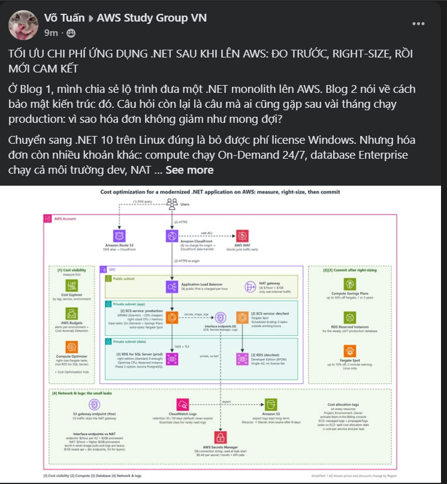
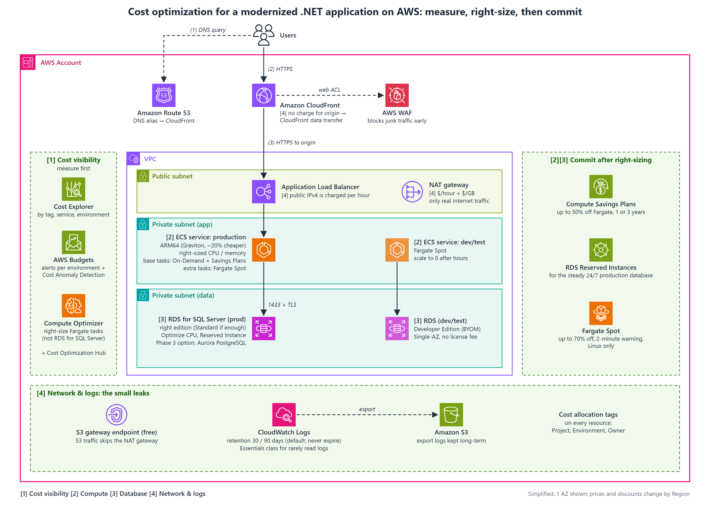

## ALREADY IN CONTAINERS, NO MORE WINDOWS LICENSES, SO WHY IS THE AWS BILL STILL HIGH? COST OPTIMIZATION FOR A .NET APPLICATION AFTER MODERNIZATION

> I also posted this article in the AWS Study Group (FCAJ) Facebook group: [view the post](https://www.facebook.com/groups/awsstudygroupfcj/posts/2341814056583553). The group is private, so only members can open the link.

In Blog 1, I shared a path for moving a .NET monolith to AWS, and Blog 2 covered how to secure that architecture. The remaining question is the one every manager asks after a few months in production: **why didn't the bill go down as expected?**

Moving to .NET 10 on Linux does remove the Windows OS cost of the workload. But the AWS bill has many other items: compute running On-Demand 24/7, an Enterprise database running even for dev, a NAT gateway charging for every GB, logs kept forever. None of these go down unless you actively optimize them.

Today I want to share what I learned about cost optimization for the target architecture from Blog 1, split into 4 groups: **cost visibility, compute, database, and network and logs**. At the end there is a real example from OrderServ, a .NET platform that cut its compute cost by up to 64%.

**Context: the application after Phase 2 of Blog 1 (and secured as in Blog 2)**

- A .NET 10 application runs as a Linux container on `Amazon ECS on AWS Fargate` (ECS Fargate for short) in a private subnet, behind `Amazon Route 53`, `Amazon CloudFront` with `AWS WAF`, and an `Application Load Balancer` (ALB), as drawn in Blog 2.
- The database is `Amazon RDS for SQL Server` (or Aurora PostgreSQL if Phase 3 is done).
- Secrets are in Secrets Manager, logs go to CloudWatch Logs, and tasks reach the Internet through a NAT gateway.
- There are at least two environments: production and dev/test.

**Group 1: See the cost before optimizing it (Cost visibility)**

You cannot optimize what you cannot measure. This step should be done from day one on AWS.

- **Tag resources** (for example `Project`, `Environment`, `Owner`) and activate them as **cost allocation tags** in Billing. For ECS, turn on `enableECSManagedTags` and `propagateTags` so the tags are added to every task. This lets you separate production cost from dev/test cost.
- **AWS Cost Explorer** shows cost by service, by tag, and by ECS cluster and service, with 13 months of history and a 3-month forecast.
- **AWS Budgets** sets a budget for each environment and sends alerts when actual or forecasted cost goes over the threshold.
- **Cost Anomaly Detection** uses machine learning to detect unusual cost increases (for example, someone forgot to turn off a test environment) and sends alerts by email or SNS.
- **Cost Optimization Hub** collects savings recommendations (rightsizing, Savings Plans, Reserved Instances) in one place, including ECS tasks on Fargate and RDS.
- Before changing the architecture, use the **AWS Pricing Calculator** to compare options instead of guessing.

**Group 2: Compute (ECS Fargate)**

- **Right-size first, commit later.** Task definitions are often given CPU/memory "to be safe" during migration and never changed. `AWS Compute Optimizer` gives CPU and memory recommendations for ECS services on Fargate based on real usage. Reduce the size first and only then buy Savings Plans, otherwise you commit to paying for resources you are wasting.
- **Graviton (ARM64):** on Fargate, Linux/ARM vCPU and memory are about 20% cheaper than x86. .NET 10 runs well on `linux-arm64`, but you need to build a multi-architecture image and check that native libraries (drivers, image or PDF processing libraries) have ARM64 builds.
- **Fargate Spot:** up to 70% off Fargate On-Demand, but tasks can be reclaimed with a 2-minute warning (SIGTERM and an EventBridge event). Fargate Spot is Linux only and does not support Windows. It fits dev/test environments, batch jobs, or part of the tasks of a service that can tolerate interruption; for production, use a capacity provider strategy with a `base` on `FARGATE` so a minimum number of tasks always runs On-Demand.
- **Compute Savings Plans:** commit to an hourly spend for 1 or 3 years and get up to 50% off Fargate. The plan applies flexibly to EC2, Fargate and Lambda, so it still works if you later change how compute runs.
- **Turn off unused environments:** dev/test ECS services can scale to 0 tasks outside working hours (for example with scheduled scaling). Many teams skip this step even though it is the simplest saving.
- **Still running Windows containers?** Fargate Windows adds an OS license fee per vCPU, with a 5-minute minimum charge per task (1 minute on Linux), and Savings Plans do not discount this license fee. This is the economic reason to do Phase 2 (moving to .NET on Linux) in Blog 1.

**Group 3: Database (RDS for SQL Server)**

For a legacy .NET application, the database is usually the biggest cost, mainly because the SQL Server license is included in the RDS price (License Included).

- **Pick the right edition:** RDS for SQL Server offers Express, Web, Standard and Enterprise. Many systems move to Enterprise because on-premises used Enterprise, while Standard might be enough. Check whether the application really uses Enterprise-only features. Web edition is cheaper but, under Microsoft's license terms, may only be used for public web workloads, so it is not an option for every internal application.
- **Dev/test environments:** since 12/2025, RDS for SQL Server supports **Developer Edition** for non-production environments. It uses a bring your own media model (you upload the installation media to S3) and has no SQL Server license fee. Do not run dev/test on Enterprise License Included. Dev/test environments usually do not need Multi-AZ either.
- **Optimize CPU:** the SQL Server license is charged per vCPU. For 2xlarge and larger instances, RDS can reduce the number of vCPUs (turn off hyperthreading or reduce cores) to reduce the license part when the workload does not need that much CPU.
- **Reserved Instances:** a database that runs steadily 24/7 should use RDS Reserved Instances for 1 or 3 years. Note that an RI cannot change region, edition, instance class or term after purchase, and it does not cover storage, so right-size first.
- **Rightsizing the database:** Compute Optimizer has recommendations for RDS and Aurora, but only for MySQL and PostgreSQL; it **does not support RDS for SQL Server**. For SQL Server, you have to review CPU, memory and IOPS metrics yourself in CloudWatch and Performance Insights.
- **Phase 3 (moving to Aurora PostgreSQL):** this is the only way to remove the SQL Server license completely, but in exchange there are conversion, testing and operating costs. Once on Aurora, choose `Aurora I/O-Optimized` when I/O makes up more than 25% of your total Aurora cost.

**Group 4: Network & logging**

These are small items, but they often surprise people on the bill.

- A **NAT gateway** is charged per hour and **per GB of data processed** (about 0.045 USD/hour and 0.045 USD/GB in US East). If tasks in the private subnet pull images and call AWS APIs through NAT, every deployment costs money.
- A **gateway VPC endpoint for S3** (and DynamoDB) is **free**, so turn it on so S3 traffic does not go through NAT. **Interface endpoints** (ECR, Secrets Manager, CloudWatch Logs) avoid NAT too, but they are charged per hour in each AZ and per GB; compare against your real traffic before creating many endpoints.
- **Public IPv4:** since 02/2024, every public IPv4 address is charged 0.005 USD/hour, whether it is in use or not. Fargate tasks do not need a public IP if they are already in a private subnet.
- **CloudFront in front of the ALB:** besides the security role described in Blog 2, CloudFront also affects cost. AWS waives the data transfer charge between CloudFront and AWS origins such as the ALB, cached static content no longer hits the ECS tasks, and WAF at the edge drops junk requests before they use compute.
- **Log retention:** CloudWatch Logs log groups default to **never expire**. Set a suitable retention (for example 30 or 90 days), and export logs that must be kept longer to S3.
- The **Essentials log class** (formerly Infrequent Access) has a lower ingestion price than the Standard class, but it lacks some features such as Live Tail, metric filters and subscription filters, and the log class cannot be changed after the log group is created. It fits application logs that are mostly used for lookups during incidents; logs used for alarms or metric filters should stay in Standard.

**The architecture after applying the 4 groups:**

- All resources have `Environment` and `Project` tags; Cost Explorer, Budgets and Cost Anomaly Detection track cost per environment.
- The production ECS service runs right-sized tasks on Graviton (ARM64); the minimum number of tasks runs on Fargate On-Demand covered by Compute Savings Plans, and extra tasks can use Fargate Spot. Dev/test scales to 0 outside working hours.
- Production RDS for SQL Server uses the right edition, Optimize CPU and a Reserved Instance; dev/test uses Developer Edition in Single-AZ.
- S3 traffic goes through the free gateway endpoint; the NAT gateway is only used for traffic that really needs the Internet.
- Log groups have a clear retention, and rarely accessed logs use the Essentials class.

**A real example: OrderServ cut compute cost by up to 64%**

According to a post on the AWS Architecture Blog (05/11/2026), OrderServ is a food-ordering platform for many restaurant brands, with 21 microservices written in .NET. Before, **each brand had its own ECS cluster** on Fargate, adding a new brand took days of infrastructure work, and during traffic spikes new Fargate tasks needed 5-7 minutes to become ready.

- They moved to **one shared ECS cluster** for all brands, isolating data with a shared .NET library (a tenancy library), IAM session tags per tenant and ElastiCache RBAC.
- Compute moved from Fargate to an **EC2 Auto Scaling group running Bottlerocket with a warm pool**: instances are pre-initialized in a stopped state, cost only EBS (about 3 USD/month per instance), and start in 30-60 seconds.
- The discount comes from **Compute Savings Plans**. For 21 services in ap-south-1: Fargate On-Demand is about 1,568 USD/month; EC2 + warm pool + a 1-year Savings Plan is about 832 USD/month (**~47% less**); with a 3-year Savings Plan it is about 568 USD/month (**~64% less**).
- Passkey sign-in reduces SMS costs, and adding a new brand is now a configuration change that takes minutes.

What I find worth noting: for a small monolith like the one in Blog 1, Fargate is still a simple and sensible choice. But when the workload is large, steady and spiky, EC2 + warm pool + Savings Plans can be both cheaper and faster to scale, in exchange for the team managing EC2 capacity itself.

**My summary table (before and after):**

| Group | Common after migration | After optimization |
|---|---|---|
| 1. Cost visibility | One shared bill, no idea which environment costs money | Cost allocation tags, Cost Explorer, Budgets, Cost Anomaly Detection |
| 2. Compute | Task size "to be safe", x86, On-Demand 24/7 even for dev/test | Right-size, Graviton, Savings Plans, Fargate Spot for interruption-tolerant parts, dev/test off outside working hours |
| 3. Database | Enterprise License Included for every environment | Right edition, Developer Edition for dev/test, Optimize CPU, Reserved Instances |
| 4. Network and logs | All traffic through NAT, logs kept forever | S3 gateway endpoint, no unneeded public IPs, retention, Essentials log class |

**Out of scope for this post:** optimizing data transfer between regions and to the Internet (CloudFront), storage and backup costs (S3 lifecycle, snapshots), a FinOps model for the whole organization, and the cost of the security tools from Blog 2 (WAF, GuardDuty).

**What I learned:**

- Moving to AWS does not make the bill cheaper by itself. Removing the Windows license is only one part; items like the database, NAT and logs are where money usually "leaks".
- Order matters: **measure, right-size, then commit** (Savings Plans, Reserved Instances). Committing before right-sizing locks in the waste for 1-3 years.
- Many cost decisions are architecture decisions. Fargate or EC2, SQL Server or PostgreSQL, NAT or VPC endpoints all have trade-offs between cost, operational effort and complexity.

**Conclusion:**

For a .NET application after modernization, cost optimization starts with seeing where the money goes, right-sizing compute and the database, choosing the right way to buy (Savings Plans, Reserved Instances, Spot), and then cleaning up the small items in networking and logs. Like security in Blog 2, cost should be considered from the start of the modernization path, instead of waiting for the first monthly bill to be surprised.

**Personal perspective:** this post is my synthesis from several sources (the AWS Architecture Blog, AWS documentation and pricing pages, and First Cloud Journey workshops) and the still-limited view of someone who is learning, so it surely has gaps. Prices in this post are for reference only (mostly US East) and can differ by region and over time. I would really appreciate feedback from everyone, especially those who have optimized costs for .NET workloads on AWS.

**References:**

- [AWS Architecture Blog – How OrderServ achieved up to 64% cost savings with multi-tenant ECS](https://aws.amazon.com/blogs/architecture/how-orderserv-achieved-up-to-64-cost-savings-with-multi-tenant-ecs/)
- [AWS – AWS Fargate pricing](https://aws.amazon.com/fargate/pricing/)
- [AWS Docs – Amazon ECS capacity providers for Fargate (Fargate Spot)](https://docs.aws.amazon.com/AmazonECS/latest/developerguide/fargate-capacity-providers.html)
- [AWS – Compute Savings Plans pricing](https://aws.amazon.com/savingsplans/compute-pricing/)
- [AWS Docs – AWS Compute Optimizer supported resources](https://docs.aws.amazon.com/compute-optimizer/latest/ug/supported-resources.html)
- [AWS Docs – Cost Optimization Hub](https://docs.aws.amazon.com/cost-management/latest/userguide/cost-optimization-hub.html)
- [AWS – Amazon RDS for SQL Server pricing](https://aws.amazon.com/rds/sqlserver/pricing/)
- [AWS Docs – Working with SQL Server Developer Edition on RDS for SQL Server](https://docs.aws.amazon.com/AmazonRDS/latest/UserGuide/sqlserver-dev-edition.html)
- [AWS – Amazon Aurora pricing](https://aws.amazon.com/rds/aurora/pricing/)
- [AWS – Amazon VPC pricing (NAT gateway, public IPv4)](https://aws.amazon.com/vpc/pricing/)
- [AWS – Amazon CloudFront pricing](https://aws.amazon.com/cloudfront/pricing/)
- [AWS Docs – CloudWatch Logs log classes](https://docs.aws.amazon.com/AmazonCloudWatch/latest/logs/CloudWatch_Logs_Log_Classes.html)
- [AWS Docs – Amazon ECS usage reports and cost allocation](https://docs.aws.amazon.com/AmazonECS/latest/developerguide/usage-reports.html)
- [AWS Docs – Tagging Amazon ECS resources](https://docs.aws.amazon.com/AmazonECS/latest/developerguide/ecs-using-tags.html)
- [AWS Docs – AWS Cost Anomaly Detection](https://docs.aws.amazon.com/cost-management/latest/userguide/manage-ad.html)

**Hands-on workshops on First Cloud Journey (FCJ):**

- [Savings Plan, Reserved Instance and Reserved DB Instance](https://000042.awsfcaj.com)
- [Cost Management with AWS Budget](https://000007.awsfcaj.com)
- [Choose the correct EC2 size (right-sizing with Compute Optimizer)](https://000032.awsfcaj.com)
- [Manage EC2 By Tagging (cost analysis by tag with Cost Explorer)](https://000034.awsfcaj.com)
- [Cost and Usage Governance with IAM on AWS](https://000064.awsfcaj.com)

#AWS #DotNET #CostOptimization #FinOps #SavingsPlans #ECS #Fargate #RDS #AWSStudyGroupVN #FCAJ
