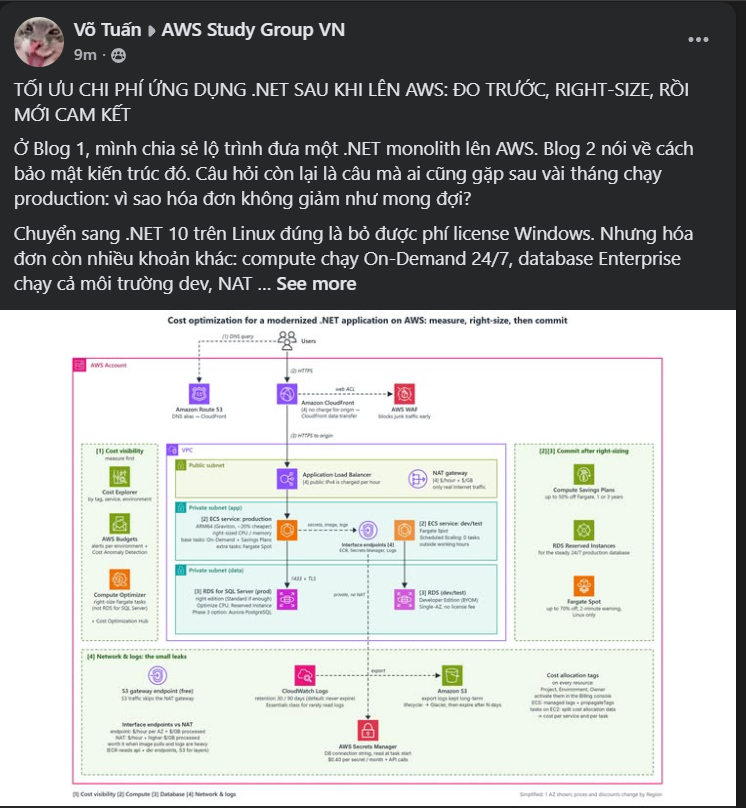
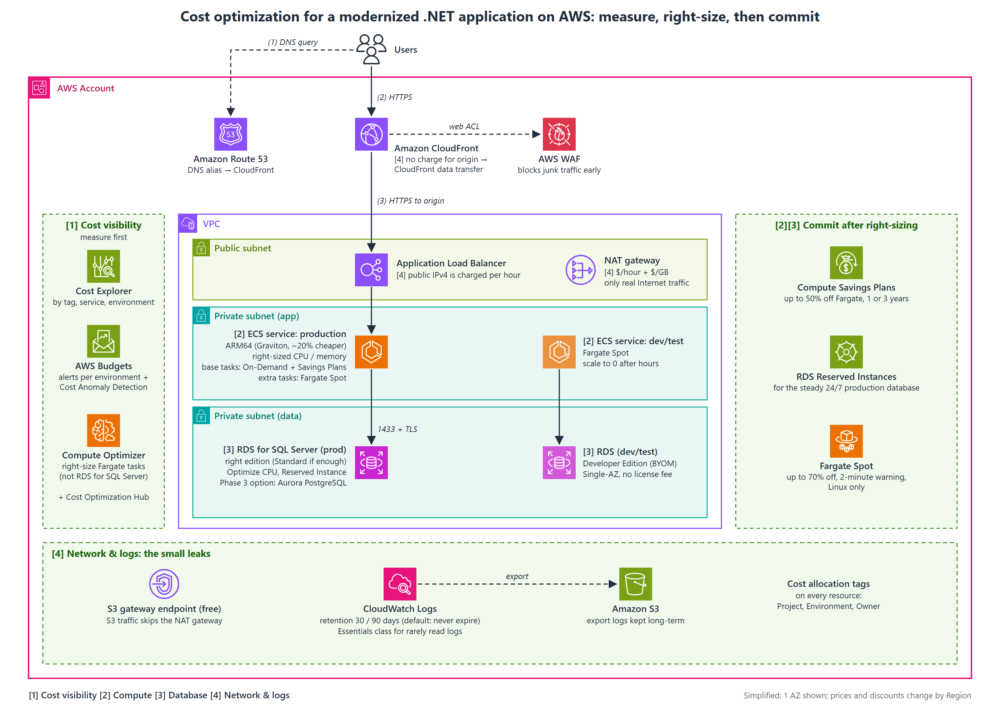

## ĐÃ LÊN CONTAINER, ĐÃ BỎ LICENSE WINDOWS, SAO HÓA ĐƠN AWS VẪN CAO? TỐI ƯU CHI PHÍ CHO ỨNG DỤNG .NET SAU KHI HIỆN ĐẠI HÓA

> Bài viết này mình đã đăng trên group Facebook AWS Study Group (FCAJ): [xem bài đăng](https://www.facebook.com/groups/awsstudygroupfcj/posts/2341814056583553). Group ở chế độ riêng tư nên chỉ thành viên mới mở được link.

Ở Blog 1, mình đã chia sẻ lộ trình đưa một .NET monolith lên AWS, và Blog 2 nói về cách bảo mật kiến trúc đó. Câu hỏi còn lại là câu mà người quản lý nào cũng hỏi sau vài tháng chạy thật: **vì sao hóa đơn không giảm như kỳ vọng?**

Chuyển sang .NET 10 trên Linux đúng là bỏ được phí hệ điều hành Windows của workload. Nhưng hóa đơn AWS còn nhiều khoản khác: compute chạy On-Demand 24/7, database Enterprise chạy cả môi trường dev, NAT gateway tính phí theo từng GB, log giữ vĩnh viễn. Không khoản nào tự giảm nếu mình không chủ động tối ưu.

Hôm nay mình muốn chia sẻ những gì mình tìm hiểu được về tối ưu chi phí cho kiến trúc đích ở Blog 1, chia thành 4 nhóm: **nhìn thấy chi phí, compute, database, mạng và log**. Cuối bài là ví dụ thực tế của OrderServ, một nền tảng .NET đã giảm tới 64% chi phí compute.

**Bối cảnh: ứng dụng sau Phase 2 của Blog 1 (và đã bảo mật theo Blog 2)**

- Ứng dụng .NET 10 chạy container Linux trên `Amazon ECS on AWS Fargate` (gọi tắt là ECS Fargate) trong private subnet, phía sau `Amazon Route 53`, `Amazon CloudFront` có `AWS WAF`, và `Application Load Balancer` (ALB), đúng như sơ đồ ở Blog 2.
- Database là `Amazon RDS for SQL Server` (hoặc Aurora PostgreSQL nếu đã làm Phase 3).
- Secret nằm trong Secrets Manager, log gửi lên CloudWatch Logs, task ra Internet qua NAT gateway.
- Có ít nhất hai môi trường: production và dev/test.

**Nhóm 1: Nhìn thấy chi phí trước khi tối ưu (Cost visibility)**

Không đo được thì không tối ưu được. Đây là bước nên làm ngay từ ngày đầu lên AWS.

- **Gắn tag cho tài nguyên** (ví dụ `Project`, `Environment`, `Owner`) rồi bật chúng thành **cost allocation tag** trong Billing. Với ECS, bật `enableECSManagedTags` và `propagateTags` để tag tự gắn vào từng task. Nhờ vậy có thể tách được chi phí production với dev/test.
- **AWS Cost Explorer** xem chi phí theo dịch vụ, theo tag, theo ECS cluster và service, có 13 tháng lịch sử và dự báo 3 tháng tới.
- **AWS Budgets** đặt ngân sách cho từng môi trường và gửi cảnh báo khi chi phí thực tế hoặc dự báo vượt ngưỡng.
- **Cost Anomaly Detection** dùng machine learning để phát hiện chi phí tăng bất thường (ví dụ ai đó quên tắt môi trường test), gửi cảnh báo qua email hoặc SNS.
- **Cost Optimization Hub** gom các đề xuất tiết kiệm (rightsizing, Savings Plans, Reserved Instances) vào một chỗ, có cả ECS task trên Fargate và RDS.
- Trước khi thay đổi kiến trúc, dùng **AWS Pricing Calculator** để so sánh các phương án, thay vì đoán.

**Nhóm 2: Compute (ECS Fargate)**

- **Right-size trước, cam kết sau.** Task definition thường được khai báo CPU/memory "cho chắc" lúc migrate rồi giữ nguyên. `AWS Compute Optimizer` có đề xuất CPU và memory cho ECS service chạy trên Fargate dựa trên số liệu sử dụng thực tế. Giảm size trước rồi mới mua Savings Plans, nếu không sẽ cam kết cho phần tài nguyên đang lãng phí.
- **Graviton (ARM64):** trên Fargate, giá vCPU và memory của Linux/ARM rẻ hơn khoảng 20% so với x86. .NET 10 chạy tốt trên `linux-arm64`, nhưng cần build image đa kiến trúc và kiểm tra các thư viện native (driver, thư viện xử lý ảnh, PDF) có bản ARM64 hay không.
- **Fargate Spot:** giảm tới 70% so với Fargate On-Demand, nhưng task có thể bị thu hồi với cảnh báo trước 2 phút (SIGTERM và sự kiện EventBridge). Fargate Spot chỉ có cho Linux, không hỗ trợ Windows. Hợp với môi trường dev/test, job batch, hoặc một phần task của service có thể chịu gián đoạn; với production nên dùng capacity provider strategy có `base` trên `FARGATE` để luôn giữ số task tối thiểu chạy On-Demand.
- **Compute Savings Plans:** cam kết một mức chi tiêu theo giờ trong 1 hoặc 3 năm, giảm tới 50% cho Fargate. Plan này áp dụng linh hoạt cho EC2, Fargate và Lambda, nên vẫn dùng được nếu sau này đổi cách chạy compute.
- **Tắt môi trường không dùng:** dev/test có thể scale ECS service về 0 task ngoài giờ làm việc (ví dụ dùng scheduled scaling). Nhiều team bỏ qua bước này dù đây là cách tiết kiệm đơn giản nhất.
- **Còn chạy Windows container?** Fargate Windows cộng thêm phí license hệ điều hành theo vCPU, tính tối thiểu 5 phút mỗi task (Linux là 1 phút), và Savings Plans không giảm phần phí license này. Đây là lý do kinh tế để làm Phase 2 (lên .NET trên Linux) ở Blog 1.

**Nhóm 3: Database (RDS for SQL Server)**

Với ứng dụng .NET legacy, database thường là khoản lớn nhất, chủ yếu vì license SQL Server đã nằm trong giá RDS (License Included).

- **Chọn đúng edition:** RDS for SQL Server có Express, Web, Standard và Enterprise. Nhiều hệ thống lên Enterprise vì on-premises đang dùng Enterprise, trong khi Standard có thể đủ. Cần kiểm tra ứng dụng có thật sự dùng tính năng chỉ có ở Enterprise hay không. Web edition rẻ nhưng chỉ được dùng cho workload web công khai theo điều khoản license của Microsoft, không phải lựa chọn cho mọi ứng dụng nội bộ.
- **Môi trường dev/test:** từ 12/2025, RDS for SQL Server hỗ trợ **Developer Edition** cho môi trường không phải production. Edition này theo mô hình bring your own media (tự tải bộ cài lên S3), không tính phí license SQL Server. Không nên chạy dev/test bằng Enterprise License Included. Môi trường dev/test cũng thường không cần Multi-AZ.
- **Optimize CPU:** license SQL Server tính theo vCPU. Với instance từ 2xlarge trở lên, RDS có thể giảm số vCPU (tắt hyperthreading hoặc giảm số core) để giảm phần license nếu workload không cần nhiều CPU.
- **Reserved Instances:** database chạy ổn định 24/7 nên mua RDS Reserved Instances 1 hoặc 3 năm. Lưu ý RI không đổi được region, edition, instance class hay thời hạn sau khi mua, và không áp dụng cho storage, nên làm right-size trước.
- **Rightsizing database:** Compute Optimizer có đề xuất cho RDS và Aurora, nhưng chỉ với MySQL và PostgreSQL, **không hỗ trợ RDS for SQL Server**. Với SQL Server, mình phải tự xem số liệu CPU, memory, IOPS trên CloudWatch và Performance Insights.
- **Phase 3 (đổi sang Aurora PostgreSQL):** đây là cách duy nhất để bỏ hẳn license SQL Server, nhưng đổi lại là chi phí chuyển đổi, kiểm thử và vận hành. Nếu đã lên Aurora, chọn `Aurora I/O-Optimized` khi chi phí I/O chiếm hơn 25% tổng chi phí Aurora.

**Nhóm 4: Mạng và log (Network & logging)**

Đây là những khoản nhỏ lẻ nhưng hay bị bất ngờ trên hóa đơn.

- **NAT gateway** tính phí theo giờ và theo **từng GB dữ liệu đi qua** (khoảng 0,045 USD/giờ và 0,045 USD/GB ở US East). Task trong private subnet kéo image và gọi AWS API qua NAT thì mỗi lần deploy đều tốn tiền.
- **Gateway VPC endpoint cho S3** (và DynamoDB) **miễn phí**, nên bật để traffic tới S3 không đi qua NAT. **Interface endpoint** (ECR, Secrets Manager, CloudWatch Logs) giúp tránh NAT nhưng có phí theo giờ cho mỗi AZ và theo GB; nên so sánh lượng traffic thực tế trước khi tạo hàng loạt endpoint.
- **Public IPv4:** từ 02/2024, mọi địa chỉ public IPv4 đều tính phí 0,005 USD/giờ dù đang dùng hay không. Task Fargate không cần public IP nếu đã ở private subnet.
- **CloudFront đứng trước ALB:** ngoài vai trò bảo mật đã nói ở Blog 2, CloudFront còn ảnh hưởng tới chi phí. AWS miễn phí data transfer giữa CloudFront và origin trên AWS như ALB, nội dung tĩnh được cache nên không còn đi tới task ECS, và WAF ở edge chặn request rác trước khi chúng tốn compute.
- **Thời gian lưu log:** log group trên CloudWatch Logs mặc định là **không bao giờ hết hạn**. Đặt retention phù hợp (ví dụ 30 hoặc 90 ngày), log cần giữ lâu hơn thì export sang S3.
- **Log class Essentials** (trước đây gọi là Infrequent Access) có phí ingest thấp hơn lớp Standard, nhưng thiếu một số tính năng như Live Tail, metric filter, subscription filter, và không đổi được log class sau khi tạo log group. Hợp với log ứng dụng chủ yếu dùng để tra cứu khi có sự cố; log dùng cho alarm hay metric filter thì giữ ở Standard.

**Kiến trúc sau khi áp dụng 4 nhóm tối ưu:**

- Mọi tài nguyên có tag `Environment` và `Project`; Cost Explorer, Budgets và Cost Anomaly Detection theo dõi chi phí theo từng môi trường.
- ECS service production chạy task đã right-size trên Graviton (ARM64), số task tối thiểu chạy Fargate On-Demand có Compute Savings Plans, phần tăng thêm có thể dùng Fargate Spot. Dev/test scale về 0 ngoài giờ.
- RDS for SQL Server production dùng đúng edition, Optimize CPU và Reserved Instance; dev/test dùng Developer Edition, Single-AZ.
- Traffic tới S3 đi qua gateway endpoint miễn phí; NAT gateway chỉ còn cho traffic thật sự cần ra Internet.
- Log group có retention rõ ràng, log ít truy cập dùng lớp Essentials.

**Ví dụ thực tế: OrderServ giảm tới 64% chi phí compute**

Theo bài trên AWS Architecture Blog (05/11/2026), OrderServ là nền tảng đặt món cho nhiều thương hiệu nhà hàng, có 21 microservice viết bằng .NET. Trước đây **mỗi thương hiệu có một ECS cluster riêng** trên Fargate, thêm thương hiệu mới mất vài ngày dựng hạ tầng, và khi traffic tăng đột biến thì task Fargate mới cần 5-7 phút mới sẵn sàng.

- Chuyển sang **một ECS cluster dùng chung** cho mọi thương hiệu, cô lập dữ liệu bằng một thư viện .NET dùng chung (tenancy library), IAM session tag theo tenant và RBAC của ElastiCache.
- Compute chuyển từ Fargate sang **EC2 Auto Scaling group chạy Bottlerocket có warm pool**: instance đã khởi tạo sẵn ở trạng thái stopped, chỉ tốn tiền EBS (khoảng 3 USD/tháng mỗi instance), khởi động trong 30-60 giây.
- Giảm giá bằng **Compute Savings Plans**. Với 21 service ở region ap-south-1: Fargate On-Demand khoảng 1.568 USD/tháng; EC2 + warm pool + Savings Plan 1 năm khoảng 832 USD/tháng (**giảm ~47%**); với Savings Plan 3 năm khoảng 568 USD/tháng (**giảm ~64%**).
- Đăng nhập bằng passkey giúp giảm chi phí SMS; thêm thương hiệu mới chỉ còn là thay đổi cấu hình trong vài phút.

Điều mình thấy đáng chú ý: với một monolith nhỏ như ở Blog 1, Fargate vẫn là lựa chọn đơn giản và hợp lý. Nhưng khi workload lớn, chạy ổn định và có đột biến, EC2 + warm pool + Savings Plans có thể vừa rẻ hơn vừa scale nhanh hơn, đổi lại team phải tự quản lý capacity EC2.

**Bảng tổng hợp của mình (trước và sau):**

| Nhóm | Thường gặp sau khi migrate | Sau khi tối ưu |
|---|---|---|
| 1. Nhìn thấy chi phí | Một hóa đơn chung, không biết môi trường nào tốn tiền | Cost allocation tag, Cost Explorer, Budgets, Cost Anomaly Detection |
| 2. Compute | Task size "cho chắc", x86, On-Demand 24/7 cả dev/test | Right-size, Graviton, Savings Plans, Fargate Spot cho phần chịu được gián đoạn, tắt dev/test ngoài giờ |
| 3. Database | Enterprise License Included cho mọi môi trường | Đúng edition, Developer Edition cho dev/test, Optimize CPU, Reserved Instances |
| 4. Mạng và log | Mọi traffic qua NAT, log giữ vĩnh viễn | S3 gateway endpoint, không dùng public IP thừa, retention, log class Essentials |

**Ngoài phạm vi bài này:** tối ưu chi phí data transfer giữa region và ra Internet (CloudFront), chi phí lưu trữ và backup (S3 lifecycle, snapshot), mô hình FinOps cho cả tổ chức, và chi phí của các công cụ bảo mật ở Blog 2 (WAF, GuardDuty).

**Điều mình rút ra:**

- Lên AWS không tự làm hóa đơn rẻ đi. Bỏ được license Windows mới chỉ là một phần; các khoản như database, NAT, log mới là nơi hay "rò rỉ" tiền.
- Thứ tự quan trọng: **đo, right-size, rồi mới cam kết** (Savings Plans, Reserved Instances). Cam kết trước khi right-size là khóa luôn phần lãng phí trong 1-3 năm.
- Nhiều quyết định chi phí là quyết định kiến trúc. Fargate hay EC2, SQL Server hay PostgreSQL, NAT hay VPC endpoint đều có đánh đổi giữa chi phí, công vận hành và độ phức tạp.

**Kết luận:**

Với ứng dụng .NET sau khi hiện đại hóa, tối ưu chi phí bắt đầu từ việc nhìn thấy tiền đang đi đâu, right-size compute và database, chọn đúng cách mua (Savings Plans, Reserved Instances, Spot), rồi dọn các khoản nhỏ ở mạng và log. Cũng như bảo mật ở Blog 2, chi phí nên được tính ngay từ đầu lộ trình hiện đại hóa, thay vì đợi hóa đơn tháng đầu tiên mới giật mình.

**Góc nhìn cá nhân:** bài viết được mình tổng hợp từ nhiều nguồn (AWS Architecture Blog, tài liệu và trang giá của AWS, các workshop của First Cloud Journey) cùng góc nhìn còn hạn hẹp của một người đang học, nên chắc chắn còn thiếu sót. Giá trong bài chỉ để tham khảo (chủ yếu ở US East) và có thể khác theo region và thời điểm. Mình rất mong nhận được góp ý từ mọi người, nhất là các anh chị đã từng tối ưu chi phí cho workload .NET trên AWS.

**Nguồn tham khảo:**

- [AWS Architecture Blog – How OrderServ achieved up to 64% cost savings with multi-tenant ECS](https://aws.amazon.com/blogs/architecture/how-orderserv-achieved-up-to-64-cost-savings-with-multi-tenant-ecs/)
- [AWS – AWS Fargate pricing](https://aws.amazon.com/fargate/pricing/)
- [AWS Docs – Amazon ECS capacity providers for Fargate (Fargate Spot)](https://docs.aws.amazon.com/AmazonECS/latest/developerguide/fargate-capacity-providers.html)
- [AWS – Compute Savings Plans pricing](https://aws.amazon.com/savingsplans/compute-pricing/)
- [AWS Docs – AWS Compute Optimizer supported resources](https://docs.aws.amazon.com/compute-optimizer/latest/ug/supported-resources.html)
- [AWS Docs – Cost Optimization Hub](https://docs.aws.amazon.com/cost-management/latest/userguide/cost-optimization-hub.html)
- [AWS – Amazon RDS for SQL Server pricing](https://aws.amazon.com/rds/sqlserver/pricing/)
- [AWS Docs – Working with SQL Server Developer Edition on RDS for SQL Server](https://docs.aws.amazon.com/AmazonRDS/latest/UserGuide/sqlserver-dev-edition.html)
- [AWS – Amazon Aurora pricing](https://aws.amazon.com/rds/aurora/pricing/)
- [AWS – Amazon VPC pricing (NAT gateway, public IPv4)](https://aws.amazon.com/vpc/pricing/)
- [AWS – Amazon CloudFront pricing](https://aws.amazon.com/cloudfront/pricing/)
- [AWS Docs – CloudWatch Logs log classes](https://docs.aws.amazon.com/AmazonCloudWatch/latest/logs/CloudWatch_Logs_Log_Classes.html)
- [AWS Docs – Amazon ECS usage reports and cost allocation](https://docs.aws.amazon.com/AmazonECS/latest/developerguide/usage-reports.html)
- [AWS Docs – Tagging Amazon ECS resources](https://docs.aws.amazon.com/AmazonECS/latest/developerguide/ecs-using-tags.html)
- [AWS Docs – AWS Cost Anomaly Detection](https://docs.aws.amazon.com/cost-management/latest/userguide/manage-ad.html)

**Workshop thực hành trên First Cloud Journey (FCJ):**

- [Savings Plan, Reserved Instance and Reserved DB Instance](https://000042.awsfcaj.com)
- [Cost Management with AWS Budget](https://000007.awsfcaj.com)
- [Choose the correct EC2 size (Right-sizing với Compute Optimizer)](https://000032.awsfcaj.com)
- [Manage EC2 By Tagging (phân tích chi phí theo tag với Cost Explorer)](https://000034.awsfcaj.com)
- [Cost and Usage Governance with IAM on AWS](https://000064.awsfcaj.com)

#AWS #DotNET #CostOptimization #FinOps #SavingsPlans #ECS #Fargate #RDS #AWSStudyGroupVN #FCAJ
