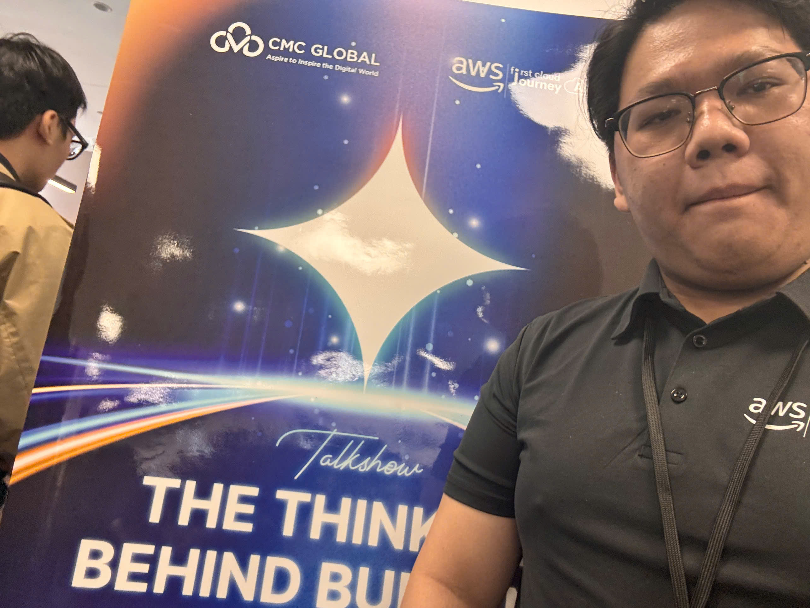

# Summary Report: “The Thinking Behind Building The Bot”

### Event Objectives

- Officially kick off **FCAJ Buildrathon 2026 (Season 01)**
- Share practical thinking on building **AI Agents**
- Connect participants with an industry partner (CMC Global)

### Speakers

- **Thien Lu** – Program Manager, FCAJ
- **Truong Bui** – Tech Lead, CMC Global
- **Phong Pham** – Program Manager, FCAJ

### Key Highlights

#### Kickoff of FCAJ Buildrathon 2026

- Starting the Buildrathon journey together with everyone

#### Talkshow “The Thinking Behind Building The Bot” with CMC Global

- **Laying a solid architecture foundation** for a bot → prioritize less critical tasks first, such as answering repetitive questions or aggregating bugs reported by users
- **Optimizing AI Agents** in an enterprise environment: always set up the agent's soul, skill and rule files so it keeps doing the right job and users cannot exploit its tokens for personal purposes

#### Breaking down the challenges

- Understanding the current difficulties of the industry, job opportunities, and future career directions

### Key Takeaways

- The learning approach and shared vision of the Buildrathon
- The mindset for setting up AI Agents: optimizing repetitive steps or steps with many unnecessary intermediate stages

### Applying to Work

- Optimize AI Agents with different rules and skills for each task (information aggregation, project security checks, ...)

### Event Experience

Attending the **“The Thinking Behind Building The Bot”** talkshow was a very valuable experience, giving me a comprehensive view of how to build and optimize AI Agents in practice. Some highlights:

#### Learning from highly skilled speakers
- The speakers shared real enterprise cases that have already been deployed to production
- Through real case studies, I better understood how to apply AI Agents to large projects in a reasonable way

### Event Photos

