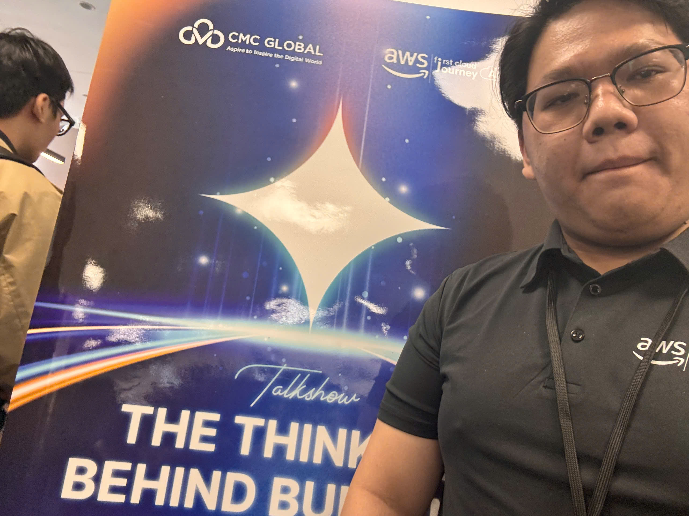

# Bài thu hoạch: “The Thinking Behind Building The Bot”

### Mục Đích Của Sự Kiện

- Chính thức khởi động **FCAJ Buildrathon 2026 (Season 01)**
- Chia sẻ tư duy thực chiến khi xây dựng **AI Agent**
- Kết nối người tham gia với đối tác doanh nghiệp (CMC Global)

### Danh Sách Diễn Giả

- **Thien Lu** – Program Manager, FCAJ
- **Truong Bui** – Tech Lead, CMC Global
- **Phong Pham** – Program Manager, FCAJ

### Nội Dung Nổi Bật

#### Khởi động FCAJ Buildrathon 2026

- Bắt đàu buildrathon cùng với mọi người

#### Talkshow “The Thinking Behind Building The Bot” cùng CMC Global

- **Đặt nền móng kiến trúc** cho Bot 1 cách chuẩn chỉnh -> ưu tiên các công việc không quá quan trọng như trả lời các câu hỏi lặp lại, tổng hợp lỗi được báo cáo từ người dùng,...
- **Tối ưu AI Agent** trong môi trường doanh nghiệp luôn phải setup các file souls, skill và rule của các AI Agent để luôn làm đúng việc cần làm và hạn chế bị người dùng khai thác token cho mục đích riêng

#### Giải mã thử thách

- Biết được khó khăn hiện tại của ngành, cơ hội việc làm và các hướng đi trong tướng lai

### Những Gì Học Được

- Cách học tập và tầm nhìn đi cùng nhau của Buildrathon
- Tư duy để setup AI Agent, tối ưu hoác các công đoạn lặp lại hoặc tốn nhiều bước trung gian không cần thiết

### Ứng Dụng Vào Công Việc

- Tối ưu hoá AI Agent bằng các rule, skill khác nhau cho từng tác vụ(tổng hợp thông tin, kiểm tra bảo mật của project,...)

### Trải nghiệm trong event

Tham gia workshop **“The Thinking Behind Building The Bot”** là một trải nghiệm rất bổ ích, giúp tôi có cái nhìn toàn diện về cách hiện đại hóa ứng dụng và cơ sở dữ liệu bằng các phương pháp và công cụ hiện đại. Một số trải nghiệm nổi bật:

#### Học hỏi từ các diễn giả có chuyên môn cao
- Các diễn giả đã chia sẻ về các trường hợp thực tế trong doanh nghiệp và đã đưa lên production
- Qua các case study thực tế, tôi hiểu rõ hơn cách áp dụng AI Agent vào các project lớn 1 cách hợp lý

### Một số hình ảnh khi tham gia sự kiện

