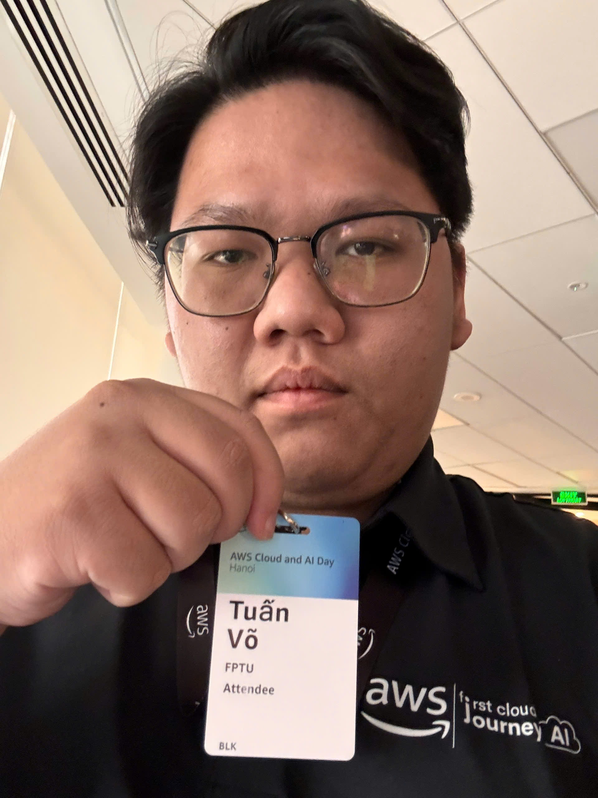

# Summary Report: “AWS Cloud Day And AI Day Hanoi - Watch party”

### Event Objectives

- Watch **AWS Cloud & AI Day Hanoi 2026** live (watch party), held in Hanoi on 29/09/2026
- Catch up on the latest trends in **Agentic AI**, data, migration and modern application development on AWS
- Hear Vietnamese companies share how they use Cloud and AI

### Speakers

- **H.E. Hoang Minh** – Deputy Minister of Science and Technology
- **H.E. Jennifer Wicks** – U.S. Ambassador to Vietnam
- **Dr. Werner Vogels** – CTO, Amazon.com
- **Eric Yeo** – Country General Manager, Malaysia, Vietnam, Indochina, AWS
- **Mai Le** – Director of Product Management, Katalon
- **Dr. Jens Lottner** – Chief Executive Officer, Techcombank

### Key Highlights

#### Keynote: “What does it take to solve problems everyone says are impossible?”

- Opened with speeches from the Ministry of Science and Technology and the U.S. Ambassador about technology cooperation
- Werner Vogels talked about solving “impossible” problems with Cloud and AI
- Techcombank and Katalon shared real stories of bringing AI into their companies

#### Sessions after the keynote

- **Building software with agentic AI** → using AI agents across the whole software process
- **From Demo to Deployment** → the hard parts of taking Agentic AI from demo to production
- **Building an AI-ready data foundation** → getting data ready before doing AI
- **Migration at Scale with Agentic AI** → using AWS Transform to move old systems to the cloud faster
- **Platform Engineering at Scale** → VPBank shared how they built an Internal Developer Platform on EKS

### Key Takeaways

- Agentic AI is AWS's main focus now, not just for chatting but for doing real work (writing code, migration, ...)
- Good AI needs well-prepared data first
- Big Vietnamese companies (banks, software companies) already run AI in production, not just experiments
- The many case studies from large-scale projects were very useful (but because the scale was so big, the talks were short and the demos a bit fast, I didn't fully understand them in depth, just enough to catch a few keywords)

### Applying to Work

- Try AI agents to help write code and tests in projects, but still review the results
- Pay attention to how data is organized from the start so AI is easier to apply later

### Event Experience

- An exciting, lively atmosphere both in Hanoi and at the Watch Party
- Getting to see highly experienced speakers share their perspectives clearly, along with practical case studies

### Event Photos

