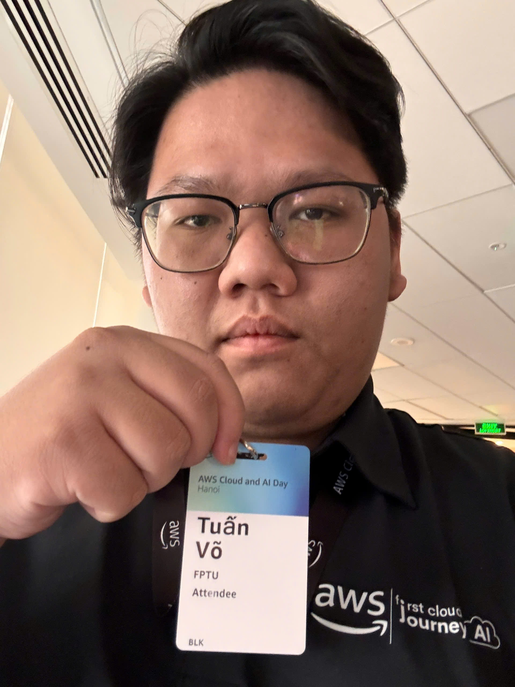

# Bài thu hoạch: “AWS Cloud Day And AI Day Hanoi - Watch party”

### Mục Đích Của Sự Kiện

- Xem trực tiếp (watch party) **AWS Cloud & AI Day Hanoi 2026** diễn ra tại Hà Nội ngày 29/09/2026
- Cập nhật xu hướng mới về **Agentic AI**, dữ liệu, migration và phát triển ứng dụng hiện đại trên AWS
- Nghe các doanh nghiệp Việt Nam chia sẻ cách họ đang dùng Cloud và AI

### Danh Sách Diễn Giả

- **H.E. Hoàng Minh** – Thứ trưởng Bộ Khoa học và Công nghệ
- **H.E. Jennifer Wicks** – Đại sứ Hoa Kỳ tại Việt Nam
- **Dr. Werner Vogels** – CTO, Amazon.com
- **Eric Yeo** – Country General Manager, Malaysia, Vietnam, Indochina, AWS
- **Mai Le** – Director of Product Management, Katalon
- **Dr. Jens Lottner** – Chief Executive Officer, Techcombank

### Nội Dung Nổi Bật

#### Keynote: “What does it take to solve problems everyone says are impossible?”

- Mở màn bằng phần phát biểu của Bộ KH&CN và Đại sứ Hoa Kỳ về hợp tác công nghệ
- Werner Vogels nói về cách giải những bài toán “tưởng là không thể” bằng Cloud và AI
- Techcombank và Katalon chia sẻ câu chuyện thực tế khi đưa AI vào doanh nghiệp

#### Các session sau keynote

- **Building software with agentic AI** → dùng AI agent để hỗ trợ cả quy trình làm phần mềm
- **From Demo to Deployment** → khó khăn khi đưa Agentic AI từ bản demo lên production
- **Building an AI-ready data foundation** → chuẩn bị dữ liệu trước khi làm AI
- **Migration at Scale with Agentic AI** → dùng AWS Transform để chuyển hệ thống cũ lên cloud nhanh hơn
- **Platform Engineering at Scale** → VPBank chia sẻ cách xây Internal Developer Platform trên EKS

### Những Gì Học Được

- Agentic AI đang là trọng tâm của AWS, không chỉ để chat mà để làm việc thật (viết code, migration,...)
- Muốn làm AI tốt thì dữ liệu phải được chuẩn bị tốt trước
- Doanh nghiệp lớn ở Việt Nam (ngân hàng, công ty phần mềm) đã đưa AI vào production chứ không còn dừng ở thử nghiệm
- Rất nhiều case study từ các dự án tầm cỡ lớn rất bổ ích (nhưng vì scale quá to và thời gian thuyết trình khá hạn chế và demo hơi nhanh nên không thật sự hiểu sâu chỉ vừa đủ nắm 1 vài keyword)

### Ứng Dụng Vào Công Việc

- Thử dùng AI agent để hỗ trợ viết code và test trong project, nhưng vẫn review lại kết quả
- Để ý cách tổ chức dữ liệu ngay từ đầu để sau này dễ áp dụng AI

### Trải nghiệm trong event

- Không khí sôi động đầy hào hứng từ cả Hà Nội lẫn Watch Party
- Được quan sát các nhân vật có nhiều kinh nghiệm và chia sẻ trực quan góc nhìn của mình cùng với các case study thiết thực

### Một số hình ảnh khi tham gia sự kiện

