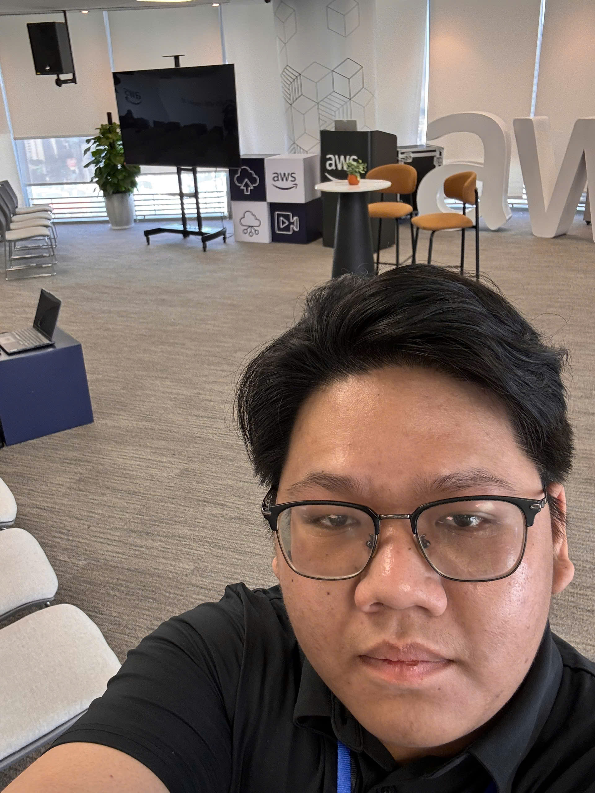

# Summary Report: “Fireside Chat with Dr. Werner Vogels”

### Event Objectives

- Meet and talk with **Dr. Werner Vogels**, CTO of Amazon
- Hear his view on the future of **Cloud and AI**
- Learn from Amazon's experience building and running systems at global scale

### Speakers

- **Dr. Werner Vogels** – Chief Technology Officer & Vice President, Amazon
- **My Nguyen** – Sr. Prototyping Architect, AWS Vietnam
### Key Highlights

#### The story behind Dynamo

- Amazon once had its system down for a whole day during the shopping season because its relational database was overloaded → millions of dollars lost
- Looking back, most of the data only needed simple key-value lookups, and very little really needed a relational database
- So Amazon built its own key-value store, the ancestor of **DynamoDB**

#### How Amazon runs its systems

- Don't look at the average, look at **P99.9** to see what the slowest users are going through
- **“Everything fails all the time”** → design the system to keep running when a data center fails
- **GameDays**: deliberately shut down real data centers to test whether the system can fail over on its own

#### “Renaissance Developer”

- A developer in the AI era needs to: stay curious and keep learning, think in systems, own the code they ship, go deep in one area while understanding the others, and communicate well with the team and customers

#### AI is just a tool

- AI makes prototyping much faster, but the code it writes still has to be checked by a human
- Grace Hopper said: *“The most dangerous phrase is: ‘We’ve always done it this way.’”*

### Key Takeaways

- Choose technology based on what the system really needs, not out of habit
- Always be prepared for the system to fail
- Developers are still needed with AI around, as long as they keep learning and take ownership of their work

### Applying to Work

- Review and test AI-written code carefully before using it (security, edge cases, ...)
- Look at how the data is actually used before choosing a database for a project

### Event Experience

Hearing Amazon's CTO speak in person was a really memorable experience. Some highlights:

#### Real stories from someone who was there
- Instead of theory, Werner told real incidents and decisions from Amazon, which made it easy to understand why AWS services are designed the way they are
- The part about developers in the AI era made me worry less and showed me which skills I need to work on

### Event Photos

