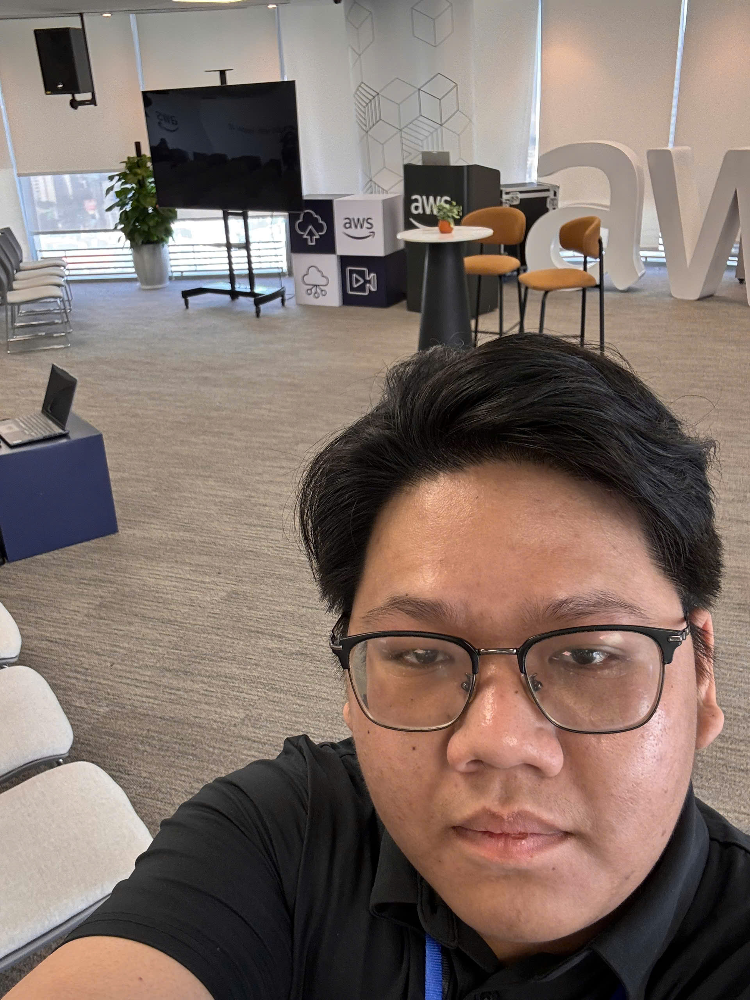

# Bài thu hoạch: “Fireside Chat with Dr. Werner Vogels”

### Mục Đích Của Sự Kiện

- Giao lưu trực tiếp với **Dr. Werner Vogels**, CTO của Amazon
- Nghe chia sẻ về tương lai của **Cloud và AI**
- Học từ kinh nghiệm xây dựng và vận hành hệ thống ở quy mô toàn cầu của Amazon

### Danh Sách Diễn Giả

- **Dr. Werner Vogels** – Chief Technology Officer & Vice President, Amazon
- **My Nguyen** – Sr. Prototyping Architect, AWS Vietnam

### Nội Dung Nổi Bật

#### Câu chuyện ra đời của Dynamo

- Amazon từng bị sập hệ thống cả ngày vào mùa mua sắm vì database quan hệ bị quá tải → mất hàng triệu đô
- Khi xem lại thì phần lớn dữ liệu chỉ cần tra cứu key-value đơn giản, rất ít phần thật sự cần database quan hệ
- Từ đó Amazon tự xây kho key-value riêng, là tiền thân của **DynamoDB**

#### Cách Amazon vận hành hệ thống

- Không nhìn số trung bình mà nhìn **P99.9** để biết người dùng chậm nhất đang gặp gì
- **“Everything fails all the time”** → thiết kế sẵn để hệ thống vẫn chạy khi có data center bị lỗi
- **GameDays**: cố tình tắt data center thật để test xem hệ thống có tự chuyển đổi được không

#### “Renaissance Developer”

- Lập trình viên thời AI cần: luôn tò mò học hỏi, có tư duy hệ thống, chịu trách nhiệm với code mình đưa lên, biết sâu một mảng nhưng hiểu rộng các mảng khác, và giao tiếp tốt với team và khách hàng

#### AI chỉ là công cụ

- AI giúp làm prototype nhanh hơn rất nhiều, nhưng code nó viết ra vẫn phải được con người kiểm tra lại
- Grace Hopper đã từng nói: *“Câu nói nguy hiểm nhất là: ‘Chúng ta vẫn luôn làm như vậy.’”*

### Những Gì Học Được

- Chọn công nghệ theo nhu cầu thật của hệ thống chứ không theo thói quen
- Luôn chuẩn bị cho việc hệ thống sẽ bị lỗi
- Có AI rồi thì lập trình viên vẫn cần thiết, miễn là chịu học và chịu trách nhiệm với sản phẩm của mình

### Ứng Dụng Vào Công Việc

- Review và test kỹ code do AI viết trước khi dùng (bảo mật, edge case,...)
- Xem kỹ cách dữ liệu được dùng trước khi chọn loại database cho project

### Trải nghiệm trong event

Được nghe trực tiếp CTO của Amazon chia sẻ là một trải nghiệm rất đáng nhớ. Một số điều nổi bật:

#### Câu chuyện thực tế từ người trong cuộc
- Thay vì lý thuyết, Werner kể lại những sự cố và quyết định thật của Amazon, nên rất dễ hiểu vì sao các dịch vụ AWS được thiết kế như hiện nay
- Phần nói về lập trình viên trong thời AI giúp tôi bớt lo lắng hơn và biết mình cần rèn thêm những kỹ năng gì

### Một số hình ảnh khi tham gia sự kiện

